# Reel test pool

325 scripted reels: 5 takes on each of 65 ideas from the [Reel ideas bank](https://claude.ai/artifact/FbSGotfQLXxMVE7u4z9Lmc). 325 are rendered here as 540p previews. Pick the ones you want, and I'll render those at full 1080p for posting.

**How to pick:** watch the previews (or skim the sheets), then mark `pick` with `y` in [picks.csv](picks.csv) or just send me the ids.

- No music is baked in. Add a trending sound in Instagram. The cuts sit on a 112.5 BPM grid, so 110–115 BPM (or 225 at double time) sounds land on the beat. Sound effects (whooshes, pops, ticks) are included, and you can turn them down in the IG editor.
- Every number is example maths and every poll is marked illustrative. There are no fake testimonials.
- Left out on purpose: pillar 7 (#111–116), C4 and C6, which need real pilot results, and #94, which you'd only post once a first pilot says yes.
- Check before posting: #82 says the claim link runs for 10 minutes and then moves on, so confirm the product does this. #93 promises a free demo only and puts pilot pricing in DMs. #100 uses Konkani phrases, so run them past a local speaker.
- Source: `content/reels/studio/src/pool/` (the React shot components are in `glass.tsx`, and the scripts are in `ideas-*.ts`). Re-render with `node scripts/render-pool.mjs <out> --only=<id>`.

## 57 · POV: your 4 PM just texted

| # | Angle | Title | Length | CTA | Preview |
| --- | --- | --- | --- | --- | --- |
| v1 | story | [POV: the 3:52 text](SCRIPTS.md#p57-v1-pov-the-3-52-text) | 19.2s | DM “DEMO” for a free demo | [mp4](previews/p57-v1-pov-the-3-52-text.mp4) |
| v2 | chat | [The 🙏 emoji costs ₹1,200](SCRIPTS.md#p57-v2-the-emoji-costs-1-200) | 18.7s | Save this for your next cancel | [mp4](previews/p57-v2-the-emoji-costs-1-200.mp4) |
| v3 | stages | [Your face at 3:52 PM](SCRIPTS.md#p57-v3-your-face-at-3-52-pm) | 17.6s | DM “DEMO” for a free demo | [mp4](previews/p57-v3-your-face-at-3-52-pm.mp4) |
| v4 | versus | [3:52 PM: you vs SlotBack](SCRIPTS.md#p57-v4-3-52-pm-you-vs-slotback) | 13.3s | DM “DEMO” for a free demo | [mp4](previews/p57-v4-3-52-pm-you-vs-slotback.mp4) |
| v5 | quickfire | [4 PM cancel speedrun](SCRIPTS.md#p57-v5-4-pm-cancel-speedrun) | 14.4s | DM “DEMO” for a free demo | [mp4](previews/p57-v5-4-pm-cancel-speedrun.mp4) |

## 58 · Things owners say at 3:55 PM

| # | Angle | Title | Length | CTA | Preview |
| --- | --- | --- | --- | --- | --- |
| v1 | quickfire | [Things owners say at 3:55](SCRIPTS.md#p58-v1-things-owners-say-at-3-55) | 18.1s | Comment below 👇 | [mp4](previews/p58-v1-things-owners-say-at-3-55.mp4) |
| v2 | stages | [The 3:55 PM countdown](SCRIPTS.md#p58-v2-the-3-55-pm-countdown) | 14.4s | DM “DEMO” for a free demo | [mp4](previews/p58-v2-the-3-55-pm-countdown.mp4) |
| v3 | rank | [Rank the 3:55 lies we tell ourselves](SCRIPTS.md#p58-v3-rank-the-3-55-lies-we-tell-ourselves) | 18.1s | Comment below 👇 | [mp4](previews/p58-v3-rank-the-3-55-lies-we-tell-ourselves.mp4) |
| v4 | chat | [Texting her at 3:58](SCRIPTS.md#p58-v4-texting-her-at-3-58) | 13.9s | Save this for your next cancel | [mp4](previews/p58-v4-texting-her-at-3-58.mp4) |
| v5 | poll | [What do YOU say at 3:55?](SCRIPTS.md#p58-v5-what-do-you-say-at-3-55) | 14.4s | Comment below 👇 | [mp4](previews/p58-v5-what-do-you-say-at-3-55.mp4) |

## 59 · Rate my excuses

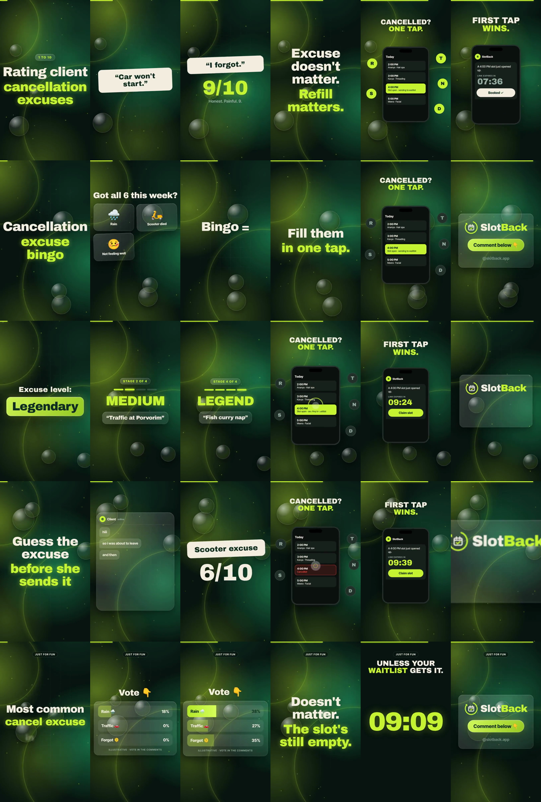

| # | Angle | Title | Length | CTA | Preview |
| --- | --- | --- | --- | --- | --- |
| v1 | rank | [Rating cancellation excuses](SCRIPTS.md#p59-v1-rating-cancellation-excuses) | 20.3s | Comment below 👇 | [mp4](previews/p59-v1-rating-cancellation-excuses.mp4) |
| v2 | quickfire | [Excuse bingo](SCRIPTS.md#p59-v2-excuse-bingo) | 13.3s | Comment below 👇 | [mp4](previews/p59-v2-excuse-bingo.mp4) |
| v3 | stages | [The excuse ladder](SCRIPTS.md#p59-v3-the-excuse-ladder) | 17.6s | Comment below 👇 | [mp4](previews/p59-v3-the-excuse-ladder.mp4) |
| v4 | chat | [The excuse, live](SCRIPTS.md#p59-v4-the-excuse-live) | 18.1s | Comment below 👇 | [mp4](previews/p59-v4-the-excuse-live.mp4) |
| v5 | poll | [Most used excuse?](SCRIPTS.md#p59-v5-most-used-excuse) | 13.3s | Comment below 👇 | [mp4](previews/p59-v5-most-used-excuse.mp4) |

## 60 · Calling 10 regulars

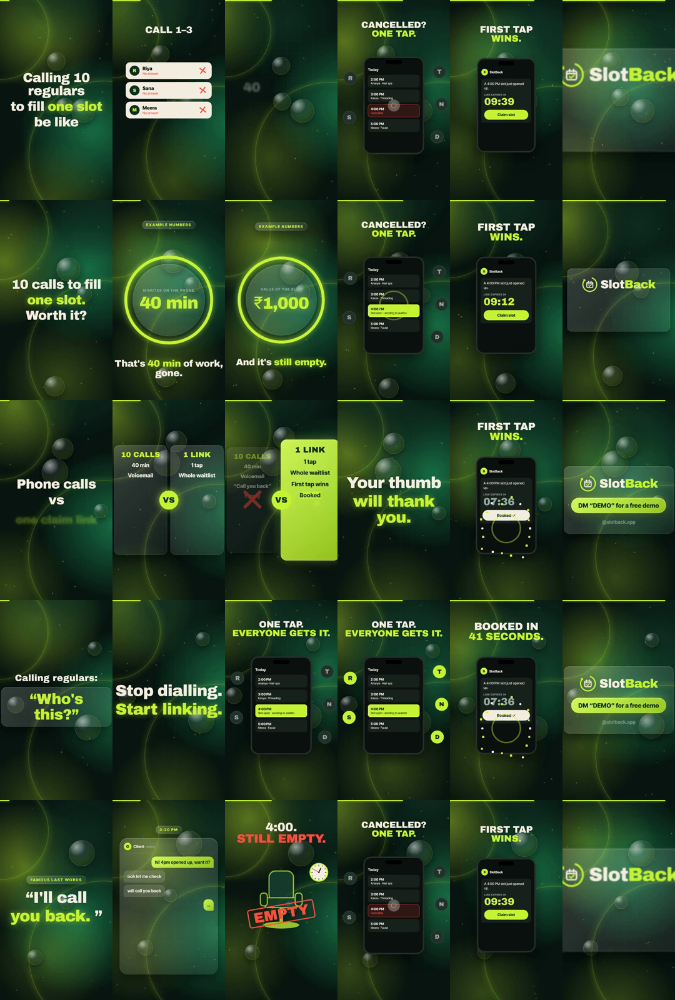

| # | Angle | Title | Length | CTA | Preview |
| --- | --- | --- | --- | --- | --- |
| v1 | story | [Calling 10 regulars be like](SCRIPTS.md#p60-v1-calling-10-regulars-be-like) | 18.1s | DM “DEMO” for a free demo | [mp4](previews/p60-v1-calling-10-regulars-be-like.mp4) |
| v2 | numbers | [What 10 calls actually cost](SCRIPTS.md#p60-v2-what-10-calls-actually-cost) | 17.1s | DM “DEMO” for a free demo | [mp4](previews/p60-v2-what-10-calls-actually-cost.mp4) |
| v3 | versus | [Calls vs claim link](SCRIPTS.md#p60-v3-calls-vs-claim-link) | 13.3s | DM “DEMO” for a free demo | [mp4](previews/p60-v3-calls-vs-claim-link.mp4) |
| v4 | quickfire | [No answer x10](SCRIPTS.md#p60-v4-no-answer-x10) | 13.3s | DM “DEMO” for a free demo | [mp4](previews/p60-v4-no-answer-x10.mp4) |
| v5 | chat | [The callback that never came](SCRIPTS.md#p60-v5-the-callback-that-never-came) | 18.1s | DM “DEMO” for a free demo | [mp4](previews/p60-v5-the-callback-that-never-came.mp4) |

## 61 · The 5 stages of a no-show

| # | Angle | Title | Length | CTA | Preview |
| --- | --- | --- | --- | --- | --- |
| v1 | stages | [The 5 stages of a no-show](SCRIPTS.md#p61-v1-the-5-stages-of-a-no-show) | 17.1s | Comment below 👇 | [mp4](previews/p61-v1-the-5-stages-of-a-no-show.mp4) |
| v2 | quickfire | [No-show stages in 10 seconds](SCRIPTS.md#p61-v2-no-show-stages-in-10-seconds) | 13.9s | DM “DEMO” for a free demo | [mp4](previews/p61-v2-no-show-stages-in-10-seconds.mp4) |
| v3 | poll | [Which stage are you at?](SCRIPTS.md#p61-v3-which-stage-are-you-at) | 14.4s | Comment below 👇 | [mp4](previews/p61-v3-which-stage-are-you-at.mp4) |
| v4 | story | [A no-show, start to finish](SCRIPTS.md#p61-v4-a-no-show-start-to-finish) | 13.3s | DM “DEMO” for a free demo | [mp4](previews/p61-v4-a-no-show-start-to-finish.mp4) |
| v5 | checklist | [No-show recovery plan](SCRIPTS.md#p61-v5-no-show-recovery-plan) | 13.3s | Save this for your next cancel | [mp4](previews/p61-v5-no-show-recovery-plan.mp4) |

## 62 · Running 5 min late becomes 40

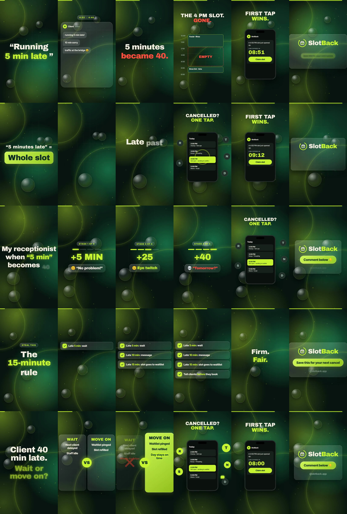

| # | Angle | Title | Length | CTA | Preview |
| --- | --- | --- | --- | --- | --- |
| v1 | chat | [“Running 5 min late”](SCRIPTS.md#p62-v1-running-5-min-late) | 16.0s | Save this for your next cancel | [mp4](previews/p62-v1-running-5-min-late.mp4) |
| v2 | numbers | [5 minutes late, ₹ cost](SCRIPTS.md#p62-v2-5-minutes-late-cost) | 17.1s | Save this for your next cancel | [mp4](previews/p62-v2-5-minutes-late-cost.mp4) |
| v3 | stages | [Receptionist's face: 5 → 40 min](SCRIPTS.md#p62-v3-receptionist-s-face-5-40-min) | 14.4s | Comment below 👇 | [mp4](previews/p62-v3-receptionist-s-face-5-40-min.mp4) |
| v4 | checklist | [The 15-minute rule](SCRIPTS.md#p62-v4-the-15-minute-rule) | 13.3s | Save this for your next cancel | [mp4](previews/p62-v4-the-15-minute-rule.mp4) |
| v5 | versus | [Wait it out vs move on](SCRIPTS.md#p62-v5-wait-it-out-vs-move-on) | 13.9s | Comment below 👇 | [mp4](previews/p62-v5-wait-it-out-vs-move-on.mp4) |

## 63 · Tell me you own a salon without telling me

| # | Angle | Title | Length | CTA | Preview |
| --- | --- | --- | --- | --- | --- |
| v1 | quickfire | [Tell me you own a salon…](SCRIPTS.md#p63-v1-tell-me-you-own-a-salon) | 16.5s | Comment below 👇 | [mp4](previews/p63-v1-tell-me-you-own-a-salon.mp4) |
| v2 | pack | [Salon owner starter pack](SCRIPTS.md#p63-v2-salon-owner-starter-pack) | 15.5s | Comment below 👇 | [mp4](previews/p63-v2-salon-owner-starter-pack.mp4) |
| v3 | chat | [Owner texts decoded](SCRIPTS.md#p63-v3-owner-texts-decoded) | 13.3s | Comment below 👇 | [mp4](previews/p63-v3-owner-texts-decoded.mp4) |
| v4 | poll | [Which one is you?](SCRIPTS.md#p63-v4-which-one-is-you) | 13.3s | Comment below 👇 | [mp4](previews/p63-v4-which-one-is-you.mp4) |
| v5 | stages | [Signs you own a salon](SCRIPTS.md#p63-v5-signs-you-own-a-salon) | 16.0s | Send this to an owner | [mp4](previews/p63-v5-signs-you-own-a-salon.mp4) |

## 64 · Monsoon in Goa = cancellation season

| # | Angle | Title | Length | CTA | Preview |
| --- | --- | --- | --- | --- | --- |
| v1 | story | [Monsoon = cancellation season](SCRIPTS.md#p64-v1-monsoon-cancellation-season) | 18.1s | DM “DEMO” for a free demo | [mp4](previews/p64-v1-monsoon-cancellation-season.mp4) |
| v2 | numbers | [What the rain costs you](SCRIPTS.md#p64-v2-what-the-rain-costs-you) | 15.5s | DM “DEMO” for a free demo | [mp4](previews/p64-v2-what-the-rain-costs-you.mp4) |
| v3 | poll | [Rain or no rain?](SCRIPTS.md#p64-v3-rain-or-no-rain) | 14.4s | Comment below 👇 | [mp4](previews/p64-v3-rain-or-no-rain.mp4) |
| v4 | checklist | [Monsoon-proof your diary](SCRIPTS.md#p64-v4-monsoon-proof-your-diary) | 13.3s | Save this for your next cancel | [mp4](previews/p64-v4-monsoon-proof-your-diary.mp4) |
| v5 | quickfire | [Rain sounds, empty chairs](SCRIPTS.md#p64-v5-rain-sounds-empty-chairs) | 13.3s | DM “DEMO” for a free demo | [mp4](previews/p64-v5-rain-sounds-empty-chairs.mp4) |

## 65 · Wedding season vs the week after

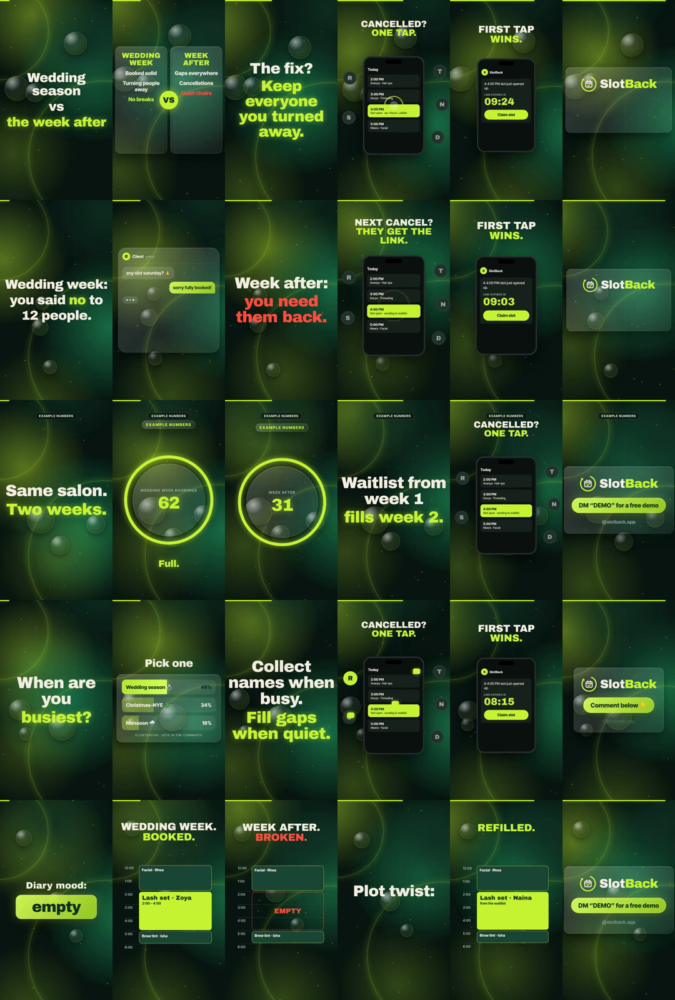

| # | Angle | Title | Length | CTA | Preview |
| --- | --- | --- | --- | --- | --- |
| v1 | versus | [Wedding season vs the week after](SCRIPTS.md#p65-v1-wedding-season-vs-the-week-after) | 17.6s | DM “DEMO” for a free demo | [mp4](previews/p65-v1-wedding-season-vs-the-week-after.mp4) |
| v2 | story | [The people you turned away](SCRIPTS.md#p65-v2-the-people-you-turned-away) | 16.5s | Save this for your next cancel | [mp4](previews/p65-v2-the-people-you-turned-away.mp4) |
| v3 | numbers | [Busy week, empty week](SCRIPTS.md#p65-v3-busy-week-empty-week) | 13.9s | DM “DEMO” for a free demo | [mp4](previews/p65-v3-busy-week-empty-week.mp4) |
| v4 | poll | [Peak season for you?](SCRIPTS.md#p65-v4-peak-season-for-you) | 14.4s | Comment below 👇 | [mp4](previews/p65-v4-peak-season-for-you.mp4) |
| v5 | quickfire | [From fully booked to empty](SCRIPTS.md#p65-v5-from-fully-booked-to-empty) | 13.3s | DM “DEMO” for a free demo | [mp4](previews/p65-v5-from-fully-booked-to-empty.mp4) |

## 66 · Pretending the empty slot is my break

| # | Angle | Title | Length | CTA | Preview |
| --- | --- | --- | --- | --- | --- |
| v1 | story | [“It's my break”](SCRIPTS.md#p66-v1-it-s-my-break) | 17.1s | Comment below 👇 | [mp4](previews/p66-v1-it-s-my-break.mp4) |
| v2 | stages | [Break or loss?](SCRIPTS.md#p66-v2-break-or-loss) | 14.4s | Comment below 👇 | [mp4](previews/p66-v2-break-or-loss.mp4) |
| v3 | numbers | [The most expensive chai in Goa](SCRIPTS.md#p66-v3-the-most-expensive-chai-in-goa) | 13.9s | DM “DEMO” for a free demo | [mp4](previews/p66-v3-the-most-expensive-chai-in-goa.mp4) |
| v4 | versus | [Planned break vs cancel break](SCRIPTS.md#p66-v4-planned-break-vs-cancel-break) | 13.3s | Save this for your next cancel | [mp4](previews/p66-v4-planned-break-vs-cancel-break.mp4) |
| v5 | quickfire | [Chai, scroll, regret](SCRIPTS.md#p66-v5-chai-scroll-regret) | 13.3s | DM “DEMO” for a free demo | [mp4](previews/p66-v5-chai-scroll-regret.mp4) |

## 67 · 3 cancellation policies that don't scare clients

| # | Angle | Title | Length | CTA | Preview |
| --- | --- | --- | --- | --- | --- |
| v1 | list | [3 policies that don't scare clients](SCRIPTS.md#p67-v1-3-policies-that-don-t-scare-clients) | 14.9s | Free toolkit · link in bio | [mp4](previews/p67-v1-3-policies-that-don-t-scare-clients.mp4) |
| v2 | versus | [Scary policy vs fair policy](SCRIPTS.md#p67-v2-scary-policy-vs-fair-policy) | 13.3s | Save this for your next cancel | [mp4](previews/p67-v2-scary-policy-vs-fair-policy.mp4) |
| v3 | checklist | [Write your policy in 4 lines](SCRIPTS.md#p67-v3-write-your-policy-in-4-lines) | 13.3s | Free toolkit · link in bio | [mp4](previews/p67-v3-write-your-policy-in-4-lines.mp4) |
| v4 | poll | [Which policy would you sign?](SCRIPTS.md#p67-v4-which-policy-would-you-sign) | 14.4s | Comment below 👇 | [mp4](previews/p67-v4-which-policy-would-you-sign.mp4) |
| v5 | quickfire | [Policy rules in 10 seconds](SCRIPTS.md#p67-v5-policy-rules-in-10-seconds) | 13.3s | Save this for your next cancel | [mp4](previews/p67-v5-policy-rules-in-10-seconds.mp4) |

## 68 · Stop saying ‘no worries!’

| # | Angle | Title | Length | CTA | Preview |
| --- | --- | --- | --- | --- | --- |
| v1 | chat | [Stop saying “no worries!”](SCRIPTS.md#p68-v1-stop-saying-no-worries) | 13.3s | Save this for your next cancel | [mp4](previews/p68-v1-stop-saying-no-worries.mp4) |
| v2 | versus | [‘No worries’ vs the better reply](SCRIPTS.md#p68-v2-no-worries-vs-the-better-reply) | 13.3s | Save this for your next cancel | [mp4](previews/p68-v2-no-worries-vs-the-better-reply.mp4) |
| v3 | checklist | [3 things to say instead](SCRIPTS.md#p68-v3-3-things-to-say-instead) | 13.3s | Save this for your next cancel | [mp4](previews/p68-v3-3-things-to-say-instead.mp4) |
| v4 | quickfire | [Two words that cost you](SCRIPTS.md#p68-v4-two-words-that-cost-you) | 13.3s | Save this for your next cancel | [mp4](previews/p68-v4-two-words-that-cost-you.mp4) |
| v5 | numbers | [The rebook you didn't ask for](SCRIPTS.md#p68-v5-the-rebook-you-didn-t-ask-for) | 13.3s | Save this for your next cancel | [mp4](previews/p68-v5-the-rebook-you-didn-t-ask-for.mp4) |

## 69 · Build a waitlist in 7 days

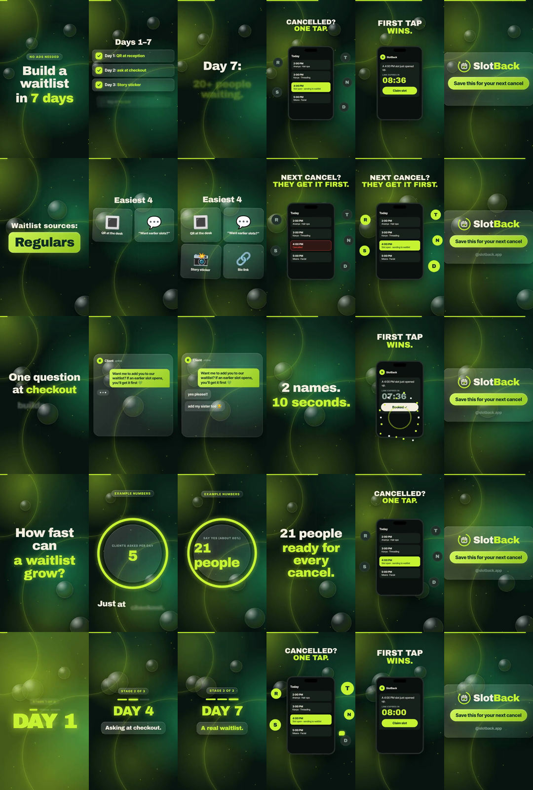

| # | Angle | Title | Length | CTA | Preview |
| --- | --- | --- | --- | --- | --- |
| v1 | steps | [Build a waitlist in 7 days](SCRIPTS.md#p69-v1-build-a-waitlist-in-7-days) | 15.5s | Save this for your next cancel | [mp4](previews/p69-v1-build-a-waitlist-in-7-days.mp4) |
| v2 | quickfire | [Where waitlists come from](SCRIPTS.md#p69-v2-where-waitlists-come-from) | 13.3s | Save this for your next cancel | [mp4](previews/p69-v2-where-waitlists-come-from.mp4) |
| v3 | chat | [The checkout question](SCRIPTS.md#p69-v3-the-checkout-question) | 13.3s | Save this for your next cancel | [mp4](previews/p69-v3-the-checkout-question.mp4) |
| v4 | numbers | [Waitlist growth, one week](SCRIPTS.md#p69-v4-waitlist-growth-one-week) | 13.3s | Save this for your next cancel | [mp4](previews/p69-v4-waitlist-growth-one-week.mp4) |
| v5 | stages | [Waitlist: day 1 vs day 7](SCRIPTS.md#p69-v5-waitlist-day-1-vs-day-7) | 13.9s | Save this for your next cancel | [mp4](previews/p69-v5-waitlist-day-1-vs-day-7.mp4) |

## 70 · The 24-hour reminder that cuts no-shows

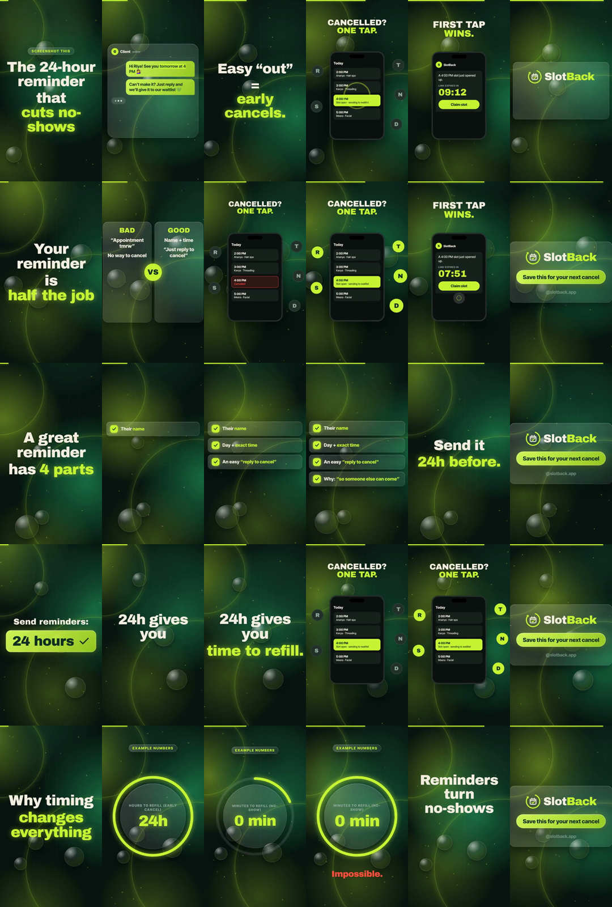

| # | Angle | Title | Length | CTA | Preview |
| --- | --- | --- | --- | --- | --- |
| v1 | chat | [The reminder that cuts no-shows](SCRIPTS.md#p70-v1-the-reminder-that-cuts-no-shows) | 17.1s | Save this for your next cancel | [mp4](previews/p70-v1-the-reminder-that-cuts-no-shows.mp4) |
| v2 | versus | [Bad reminder vs good reminder](SCRIPTS.md#p70-v2-bad-reminder-vs-good-reminder) | 13.3s | Save this for your next cancel | [mp4](previews/p70-v2-bad-reminder-vs-good-reminder.mp4) |
| v3 | checklist | [4 parts of a great reminder](SCRIPTS.md#p70-v3-4-parts-of-a-great-reminder) | 13.3s | Save this for your next cancel | [mp4](previews/p70-v3-4-parts-of-a-great-reminder.mp4) |
| v4 | quickfire | [When to send reminders](SCRIPTS.md#p70-v4-when-to-send-reminders) | 13.3s | Save this for your next cancel | [mp4](previews/p70-v4-when-to-send-reminders.mp4) |
| v5 | numbers | [Late cancel vs early cancel](SCRIPTS.md#p70-v5-late-cancel-vs-early-cancel) | 13.3s | Save this for your next cancel | [mp4](previews/p70-v5-late-cancel-vs-early-cancel.mp4) |

## 71 · Why your Tuesday 2 PM is always empty

| # | Angle | Title | Length | CTA | Preview |
| --- | --- | --- | --- | --- | --- |
| v1 | story | [Why Tuesday 2 PM is always empty](SCRIPTS.md#p71-v1-why-tuesday-2-pm-is-always-empty) | 15.5s | Save this for your next cancel | [mp4](previews/p71-v1-why-tuesday-2-pm-is-always-empty.mp4) |
| v2 | poll | [Your deadest slot?](SCRIPTS.md#p71-v2-your-deadest-slot) | 13.3s | Comment below 👇 | [mp4](previews/p71-v2-your-deadest-slot.mp4) |
| v3 | checklist | [Fill your off-peak slots](SCRIPTS.md#p71-v3-fill-your-off-peak-slots) | 13.3s | Save this for your next cancel | [mp4](previews/p71-v3-fill-your-off-peak-slots.mp4) |
| v4 | numbers | [What dead slots cost](SCRIPTS.md#p71-v4-what-dead-slots-cost) | 13.3s | DM “DEMO” for a free demo | [mp4](previews/p71-v4-what-dead-slots-cost.mp4) |
| v5 | quickfire | [Tuesday 2 PM energy](SCRIPTS.md#p71-v5-tuesday-2-pm-energy) | 13.3s | DM “DEMO” for a free demo | [mp4](previews/p71-v5-tuesday-2-pm-energy.mp4) |

## 72 · Deposits: yes or no?

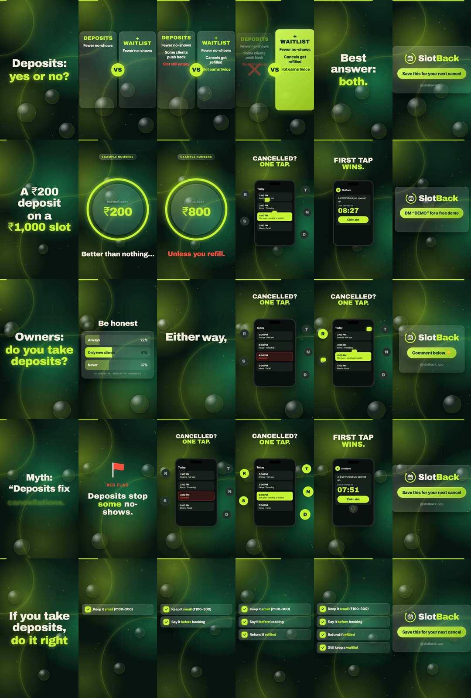

| # | Angle | Title | Length | CTA | Preview |
| --- | --- | --- | --- | --- | --- |
| v1 | versus | [Deposits: yes or no?](SCRIPTS.md#p72-v1-deposits-yes-or-no) | 13.3s | Save this for your next cancel | [mp4](previews/p72-v1-deposits-yes-or-no.mp4) |
| v2 | numbers | [What a deposit actually covers](SCRIPTS.md#p72-v2-what-a-deposit-actually-covers) | 14.9s | DM “DEMO” for a free demo | [mp4](previews/p72-v2-what-a-deposit-actually-covers.mp4) |
| v3 | poll | [Do you take deposits?](SCRIPTS.md#p72-v3-do-you-take-deposits) | 13.3s | Comment below 👇 | [mp4](previews/p72-v3-do-you-take-deposits.mp4) |
| v4 | myth | [Myth: deposits fix cancellations](SCRIPTS.md#p72-v4-myth-deposits-fix-cancellations) | 13.3s | Save this for your next cancel | [mp4](previews/p72-v4-myth-deposits-fix-cancellations.mp4) |
| v5 | checklist | [If you do take deposits](SCRIPTS.md#p72-v5-if-you-do-take-deposits) | 13.3s | Save this for your next cancel | [mp4](previews/p72-v5-if-you-do-take-deposits.mp4) |

## 73 · Do this the moment a client cancels

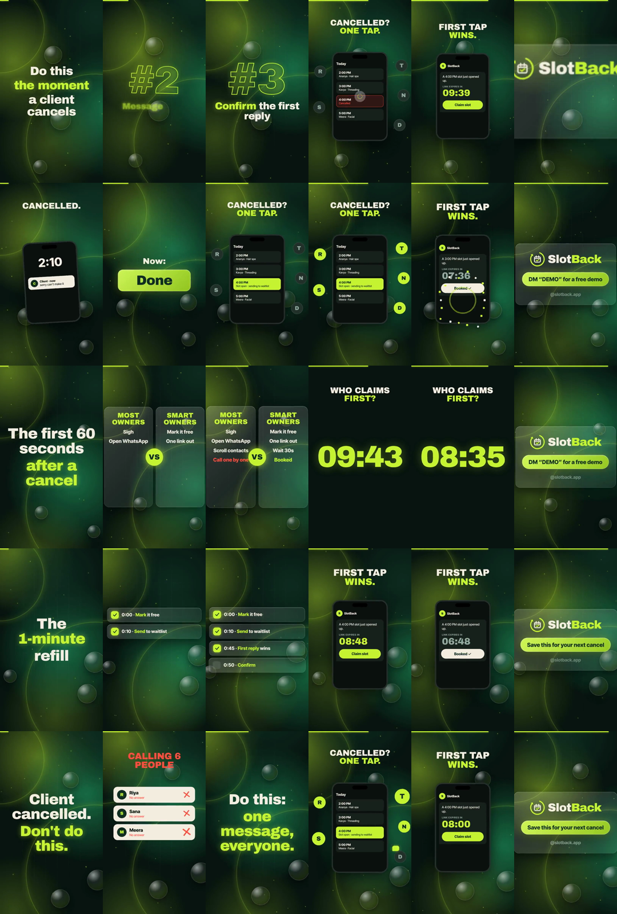

| # | Angle | Title | Length | CTA | Preview |
| --- | --- | --- | --- | --- | --- |
| v1 | steps | [Do this the moment someone cancels](SCRIPTS.md#p73-v1-do-this-the-moment-someone-cancels) | 18.1s | Save this for your next cancel | [mp4](previews/p73-v1-do-this-the-moment-someone-cancels.mp4) |
| v2 | quickfire | [Cancel → refill in 3 taps](SCRIPTS.md#p73-v2-cancel-refill-in-3-taps) | 13.3s | DM “DEMO” for a free demo | [mp4](previews/p73-v2-cancel-refill-in-3-taps.mp4) |
| v3 | versus | [First 60 seconds after a cancel](SCRIPTS.md#p73-v3-first-60-seconds-after-a-cancel) | 13.3s | DM “DEMO” for a free demo | [mp4](previews/p73-v3-first-60-seconds-after-a-cancel.mp4) |
| v4 | checklist | [The 1-minute refill](SCRIPTS.md#p73-v4-the-1-minute-refill) | 13.3s | Save this for your next cancel | [mp4](previews/p73-v4-the-1-minute-refill.mp4) |
| v5 | story | [What not to do after a cancel](SCRIPTS.md#p73-v5-what-not-to-do-after-a-cancel) | 13.9s | Save this for your next cancel | [mp4](previews/p73-v5-what-not-to-do-after-a-cancel.mp4) |

## 74 · How much one empty slot costs you a year

| # | Angle | Title | Length | CTA | Preview |
| --- | --- | --- | --- | --- | --- |
| v1 | numbers | [One empty slot, one year](SCRIPTS.md#p74-v1-one-empty-slot-one-year) | 15.5s | Free toolkit · link in bio | [mp4](previews/p74-v1-one-empty-slot-one-year.mp4) |
| v2 | quickfire | [Do the maths in 5 seconds](SCRIPTS.md#p74-v2-do-the-maths-in-5-seconds) | 13.3s | Free toolkit · link in bio | [mp4](previews/p74-v2-do-the-maths-in-5-seconds.mp4) |
| v3 | poll | [Guess the yearly cost](SCRIPTS.md#p74-v3-guess-the-yearly-cost) | 15.5s | Comment below 👇 | [mp4](previews/p74-v3-guess-the-yearly-cost.mp4) |
| v4 | versus | [Refill half, keep half](SCRIPTS.md#p74-v4-refill-half-keep-half) | 13.3s | DM “DEMO” for a free demo | [mp4](previews/p74-v4-refill-half-keep-half.mp4) |
| v5 | story | [The calculator that shocked an owner](SCRIPTS.md#p74-v5-the-calculator-that-shocked-an-owner) | 13.3s | Free toolkit · link in bio | [mp4](previews/p74-v5-the-calculator-that-shocked-an-owner.mp4) |

## 75 · The WhatsApp message that fills a slot

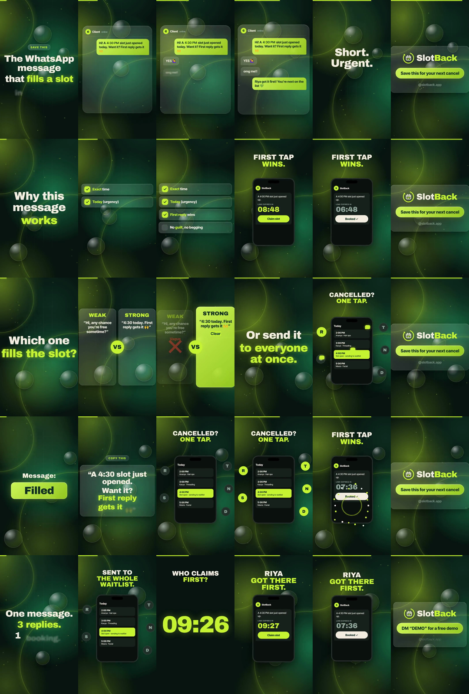

| # | Angle | Title | Length | CTA | Preview |
| --- | --- | --- | --- | --- | --- |
| v1 | chat | [The message that fills a slot](SCRIPTS.md#p75-v1-the-message-that-fills-a-slot) | 13.3s | Save this for your next cancel | [mp4](previews/p75-v1-the-message-that-fills-a-slot.mp4) |
| v2 | checklist | [Why this message works](SCRIPTS.md#p75-v2-why-this-message-works) | 13.3s | Save this for your next cancel | [mp4](previews/p75-v2-why-this-message-works.mp4) |
| v3 | versus | [Weak message vs strong message](SCRIPTS.md#p75-v3-weak-message-vs-strong-message) | 13.3s | Save this for your next cancel | [mp4](previews/p75-v3-weak-message-vs-strong-message.mp4) |
| v4 | quickfire | [Copy, paste, filled](SCRIPTS.md#p75-v4-copy-paste-filled) | 13.3s | Save this for your next cancel | [mp4](previews/p75-v4-copy-paste-filled.mp4) |
| v5 | story | [One message, 3 replies, 1 booking](SCRIPTS.md#p75-v5-one-message-3-replies-1-booking) | 14.4s | DM “DEMO” for a free demo | [mp4](previews/p75-v5-one-message-3-replies-1-booking.mp4) |

## 76 · Overbooking vs waitlist

| # | Angle | Title | Length | CTA | Preview |
| --- | --- | --- | --- | --- | --- |
| v1 | versus | [Overbooking vs waitlist](SCRIPTS.md#p76-v1-overbooking-vs-waitlist) | 13.3s | Comment below 👇 | [mp4](previews/p76-v1-overbooking-vs-waitlist.mp4) |
| v2 | poll | [Have you ever overbooked?](SCRIPTS.md#p76-v2-have-you-ever-overbooked) | 13.3s | Comment below 👇 | [mp4](previews/p76-v2-have-you-ever-overbooked.mp4) |
| v3 | story | [The overbooking disaster](SCRIPTS.md#p76-v3-the-overbooking-disaster) | 14.9s | DM “DEMO” for a free demo | [mp4](previews/p76-v3-the-overbooking-disaster.mp4) |
| v4 | quickfire | [Overbook = gamble](SCRIPTS.md#p76-v4-overbook-gamble) | 13.3s | DM “DEMO” for a free demo | [mp4](previews/p76-v4-overbook-gamble.mp4) |
| v5 | checklist | [Why waitlists beat overbooking](SCRIPTS.md#p76-v5-why-waitlists-beat-overbooking) | 13.3s | Save this for your next cancel | [mp4](previews/p76-v5-why-waitlists-beat-overbooking.mp4) |

## 77 · 3 numbers every appointment business should track

| # | Angle | Title | Length | CTA | Preview |
| --- | --- | --- | --- | --- | --- |
| v1 | list | [3 numbers to track](SCRIPTS.md#p77-v1-3-numbers-to-track) | 13.3s | Save this for your next cancel | [mp4](previews/p77-v1-3-numbers-to-track.mp4) |
| v2 | numbers | [Your refill rate, explained](SCRIPTS.md#p77-v2-your-refill-rate-explained) | 13.9s | Save this for your next cancel | [mp4](previews/p77-v2-your-refill-rate-explained.mp4) |
| v3 | quickfire | [Fill · No-show · Refill](SCRIPTS.md#p77-v3-fill-no-show-refill) | 13.3s | Save this for your next cancel | [mp4](previews/p77-v3-fill-no-show-refill.mp4) |
| v4 | poll | [Which do you track?](SCRIPTS.md#p77-v4-which-do-you-track) | 13.9s | Comment below 👇 | [mp4](previews/p77-v4-which-do-you-track.mp4) |
| v5 | checklist | [Monday numbers check](SCRIPTS.md#p77-v5-monday-numbers-check) | 13.3s | Save this for your next cancel | [mp4](previews/p77-v5-monday-numbers-check.mp4) |

## 78 · How to reply to ‘can I come earlier?’

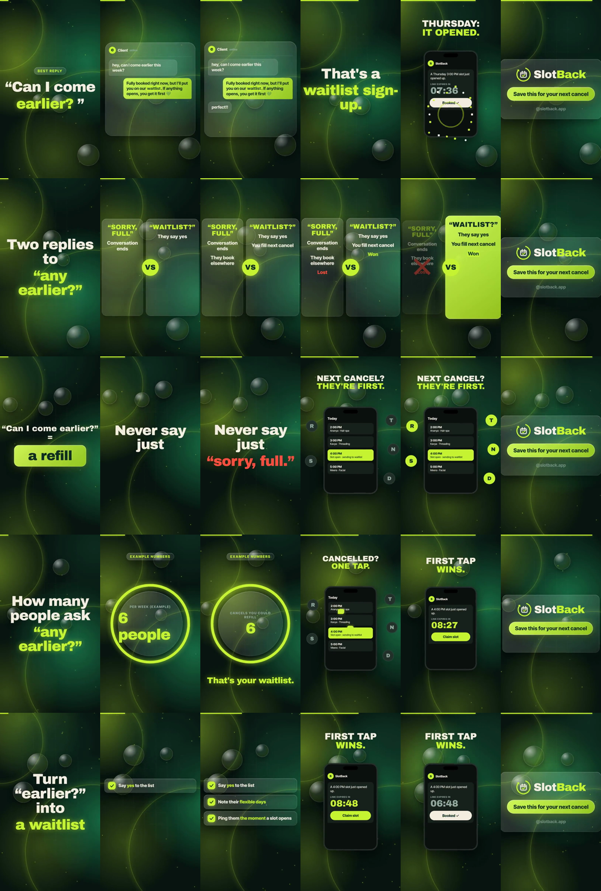

| # | Angle | Title | Length | CTA | Preview |
| --- | --- | --- | --- | --- | --- |
| v1 | chat | [“Can I come earlier?”](SCRIPTS.md#p78-v1-can-i-come-earlier) | 13.3s | Save this for your next cancel | [mp4](previews/p78-v1-can-i-come-earlier.mp4) |
| v2 | versus | [“Sorry, full” vs the waitlist reply](SCRIPTS.md#p78-v2-sorry-full-vs-the-waitlist-reply) | 13.3s | Save this for your next cancel | [mp4](previews/p78-v2-sorry-full-vs-the-waitlist-reply.mp4) |
| v3 | quickfire | [Every “earlier?” is a gift](SCRIPTS.md#p78-v3-every-earlier-is-a-gift) | 13.3s | Save this for your next cancel | [mp4](previews/p78-v3-every-earlier-is-a-gift.mp4) |
| v4 | numbers | [Earlier-requests are money](SCRIPTS.md#p78-v4-earlier-requests-are-money) | 14.9s | Save this for your next cancel | [mp4](previews/p78-v4-earlier-requests-are-money.mp4) |
| v5 | checklist | [Turn requests into sign-ups](SCRIPTS.md#p78-v5-turn-requests-into-sign-ups) | 13.3s | Save this for your next cancel | [mp4](previews/p78-v5-turn-requests-into-sign-ups.mp4) |

## 79 · Watch me fill a cancelled slot in 30 seconds

| # | Angle | Title | Length | CTA | Preview |
| --- | --- | --- | --- | --- | --- |
| v1 | demo | [Fill a cancelled slot in 30s](SCRIPTS.md#p79-v1-fill-a-cancelled-slot-in-30s) | 16.5s | DM “DEMO” for a free demo | [mp4](previews/p79-v1-fill-a-cancelled-slot-in-30s.mp4) |
| v2 | quickfire | [30-second refill speedrun](SCRIPTS.md#p79-v2-30-second-refill-speedrun) | 13.3s | DM “DEMO” for a free demo | [mp4](previews/p79-v2-30-second-refill-speedrun.mp4) |
| v3 | versus | [30 seconds vs 40 minutes](SCRIPTS.md#p79-v3-30-seconds-vs-40-minutes) | 13.3s | DM “DEMO” for a free demo | [mp4](previews/p79-v3-30-seconds-vs-40-minutes.mp4) |
| v4 | story | [A real-time refill, step by step](SCRIPTS.md#p79-v4-a-real-time-refill-step-by-step) | 13.3s | DM “DEMO” for a free demo | [mp4](previews/p79-v4-a-real-time-refill-step-by-step.mp4) |
| v5 | numbers | [Seconds, not minutes](SCRIPTS.md#p79-v5-seconds-not-minutes) | 14.9s | DM “DEMO” for a free demo | [mp4](previews/p79-v5-seconds-not-minutes.mp4) |

## 80 · What your client sees when a slot opens

| # | Angle | Title | Length | CTA | Preview |
| --- | --- | --- | --- | --- | --- |
| v1 | demo | [What your client sees](SCRIPTS.md#p80-v1-what-your-client-sees) | 13.3s | DM “DEMO” for a free demo | [mp4](previews/p80-v1-what-your-client-sees.mp4) |
| v2 | chat | [The client's side of the story](SCRIPTS.md#p80-v2-the-client-s-side-of-the-story) | 13.3s | DM “DEMO” for a free demo | [mp4](previews/p80-v2-the-client-s-side-of-the-story.mp4) |
| v3 | quickfire | [Ping → tap → booked](SCRIPTS.md#p80-v3-ping-tap-booked) | 13.3s | DM “DEMO” for a free demo | [mp4](previews/p80-v3-ping-tap-booked.mp4) |
| v4 | checklist | [What the client never has to do](SCRIPTS.md#p80-v4-what-the-client-never-has-to-do) | 13.3s | DM “DEMO” for a free demo | [mp4](previews/p80-v4-what-the-client-never-has-to-do.mp4) |
| v5 | versus | [Owner view vs client view](SCRIPTS.md#p80-v5-owner-view-vs-client-view) | 13.3s | DM “DEMO” for a free demo | [mp4](previews/p80-v5-owner-view-vs-client-view.mp4) |

## 81 · Two clients tap at the same time

| # | Angle | Title | Length | CTA | Preview |
| --- | --- | --- | --- | --- | --- |
| v1 | demo | [Two clients tap. Who wins?](SCRIPTS.md#p81-v1-two-clients-tap-who-wins) | 13.3s | DM “DEMO” for a free demo | [mp4](previews/p81-v1-two-clients-tap-who-wins.mp4) |
| v2 | chat | [The second tapper](SCRIPTS.md#p81-v2-the-second-tapper) | 13.3s | DM “DEMO” for a free demo | [mp4](previews/p81-v2-the-second-tapper.mp4) |
| v3 | quickfire | [No double-booking, ever](SCRIPTS.md#p81-v3-no-double-booking-ever) | 13.3s | DM “DEMO” for a free demo | [mp4](previews/p81-v3-no-double-booking-ever.mp4) |
| v4 | versus | [WhatsApp group vs claim link](SCRIPTS.md#p81-v4-whatsapp-group-vs-claim-link) | 13.3s | DM “DEMO” for a free demo | [mp4](previews/p81-v4-whatsapp-group-vs-claim-link.mp4) |
| v5 | poll | [Fair or unfair?](SCRIPTS.md#p81-v5-fair-or-unfair) | 13.3s | Comment below 👇 | [mp4](previews/p81-v5-fair-or-unfair.mp4) |

## 82 · The link expires. Here's why that's genius

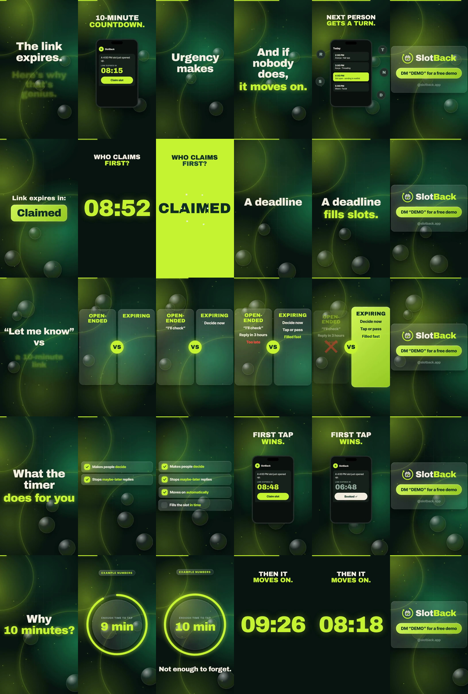

| # | Angle | Title | Length | CTA | Preview |
| --- | --- | --- | --- | --- | --- |
| v1 | story | [Why the link expires](SCRIPTS.md#p82-v1-why-the-link-expires) | 13.3s | DM “DEMO” for a free demo | [mp4](previews/p82-v1-why-the-link-expires.mp4) |
| v2 | quickfire | [Tick tock](SCRIPTS.md#p82-v2-tick-tock) | 13.3s | DM “DEMO” for a free demo | [mp4](previews/p82-v2-tick-tock.mp4) |
| v3 | versus | [Open-ended vs expiring](SCRIPTS.md#p82-v3-open-ended-vs-expiring) | 13.3s | DM “DEMO” for a free demo | [mp4](previews/p82-v3-open-ended-vs-expiring.mp4) |
| v4 | checklist | [What the timer does for you](SCRIPTS.md#p82-v4-what-the-timer-does-for-you) | 13.3s | DM “DEMO” for a free demo | [mp4](previews/p82-v4-what-the-timer-does-for-you.mp4) |
| v5 | numbers | [Why 10 minutes](SCRIPTS.md#p82-v5-why-10-minutes) | 13.3s | DM “DEMO” for a free demo | [mp4](previews/p82-v5-why-10-minutes.mp4) |

## 83 · Setting up SlotBack, start to finish

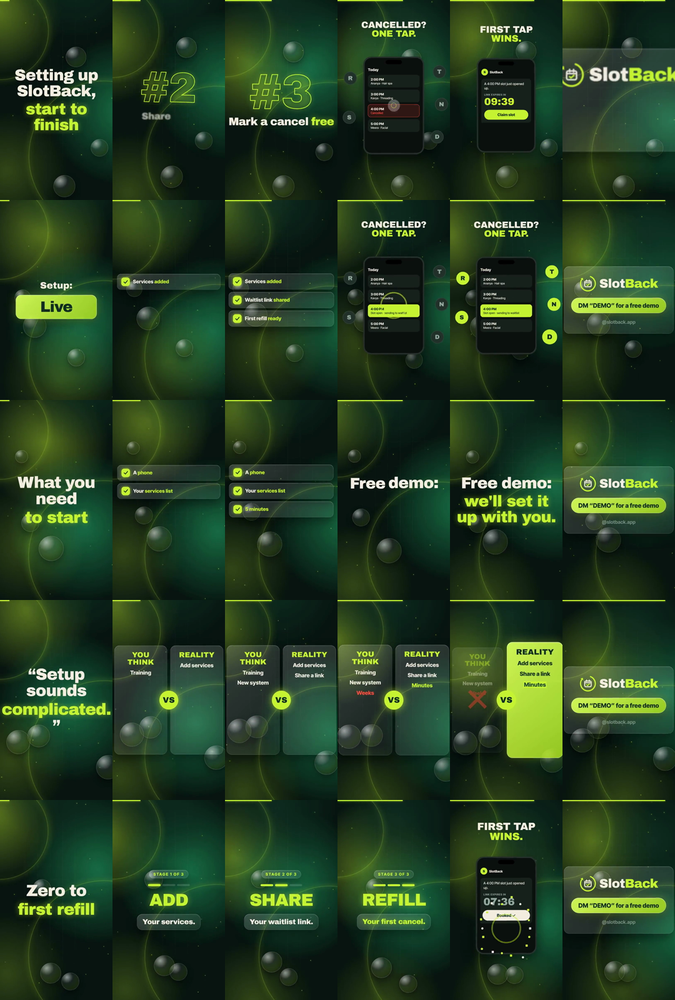

| # | Angle | Title | Length | CTA | Preview |
| --- | --- | --- | --- | --- | --- |
| v1 | steps | [Setup, start to finish](SCRIPTS.md#p83-v1-setup-start-to-finish) | 18.1s | DM “DEMO” for a free demo | [mp4](previews/p83-v1-setup-start-to-finish.mp4) |
| v2 | quickfire | [Setup in 3 taps](SCRIPTS.md#p83-v2-setup-in-3-taps) | 13.3s | DM “DEMO” for a free demo | [mp4](previews/p83-v2-setup-in-3-taps.mp4) |
| v3 | checklist | [What you need to start](SCRIPTS.md#p83-v3-what-you-need-to-start) | 13.3s | DM “DEMO” for a free demo | [mp4](previews/p83-v3-what-you-need-to-start.mp4) |
| v4 | versus | [What you think vs reality](SCRIPTS.md#p83-v4-what-you-think-vs-reality) | 13.3s | DM “DEMO” for a free demo | [mp4](previews/p83-v4-what-you-think-vs-reality.mp4) |
| v5 | stages | [From zero to first refill](SCRIPTS.md#p83-v5-from-zero-to-first-refill) | 13.3s | DM “DEMO” for a free demo | [mp4](previews/p83-v5-from-zero-to-first-refill.mp4) |

## 84 · The notification every owner wants

| # | Angle | Title | Length | CTA | Preview |
| --- | --- | --- | --- | --- | --- |
| v1 | demo | [The notification every owner wants](SCRIPTS.md#p84-v1-the-notification-every-owner-wants) | 13.3s | DM “DEMO” for a free demo | [mp4](previews/p84-v1-the-notification-every-owner-wants.mp4) |
| v2 | versus | [Bad ping vs good ping](SCRIPTS.md#p84-v2-bad-ping-vs-good-ping) | 13.3s | DM “DEMO” for a free demo | [mp4](previews/p84-v2-bad-ping-vs-good-ping.mp4) |
| v3 | quickfire | [Ping. Filled.](SCRIPTS.md#p84-v3-ping-filled) | 13.3s | DM “DEMO” for a free demo | [mp4](previews/p84-v3-ping-filled.mp4) |
| v4 | story | [Bad text, good text](SCRIPTS.md#p84-v4-bad-text-good-text) | 13.3s | DM “DEMO” for a free demo | [mp4](previews/p84-v4-bad-text-good-text.mp4) |
| v5 | numbers | [Each ping = ₹ kept](SCRIPTS.md#p84-v5-each-ping-kept) | 13.3s | DM “DEMO” for a free demo | [mp4](previews/p84-v5-each-ping-kept.mp4) |

## 85 · No app for your clients

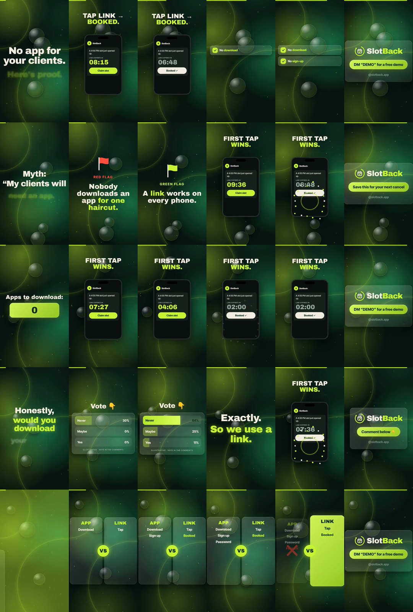

| # | Angle | Title | Length | CTA | Preview |
| --- | --- | --- | --- | --- | --- |
| v1 | demo | [No app for your clients. Proof.](SCRIPTS.md#p85-v1-no-app-for-your-clients-proof) | 13.3s | DM “DEMO” for a free demo | [mp4](previews/p85-v1-no-app-for-your-clients-proof.mp4) |
| v2 | myth | [Myth: clients need an app](SCRIPTS.md#p85-v2-myth-clients-need-an-app) | 13.3s | Save this for your next cancel | [mp4](previews/p85-v2-myth-clients-need-an-app.mp4) |
| v3 | quickfire | [Downloads needed: zero](SCRIPTS.md#p85-v3-downloads-needed-zero) | 13.3s | DM “DEMO” for a free demo | [mp4](previews/p85-v3-downloads-needed-zero.mp4) |
| v4 | poll | [Would YOU download a salon app?](SCRIPTS.md#p85-v4-would-you-download-a-salon-app) | 13.3s | Comment below 👇 | [mp4](previews/p85-v4-would-you-download-a-salon-app.mp4) |
| v5 | versus | [App vs link](SCRIPTS.md#p85-v5-app-vs-link) | 13.3s | DM “DEMO” for a free demo | [mp4](previews/p85-v5-app-vs-link.mp4) |

## 86 · Dashboard tour in 15 seconds

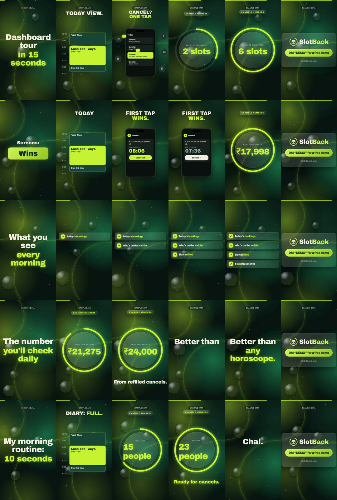

| # | Angle | Title | Length | CTA | Preview |
| --- | --- | --- | --- | --- | --- |
| v1 | demo | [Dashboard tour in 15 seconds](SCRIPTS.md#p86-v1-dashboard-tour-in-15-seconds) | 13.3s | DM “DEMO” for a free demo | [mp4](previews/p86-v1-dashboard-tour-in-15-seconds.mp4) |
| v2 | quickfire | [3 screens, 15 seconds](SCRIPTS.md#p86-v2-3-screens-15-seconds) | 13.3s | DM “DEMO” for a free demo | [mp4](previews/p86-v2-3-screens-15-seconds.mp4) |
| v3 | checklist | [What the dashboard shows](SCRIPTS.md#p86-v3-what-the-dashboard-shows) | 13.3s | DM “DEMO” for a free demo | [mp4](previews/p86-v3-what-the-dashboard-shows.mp4) |
| v4 | numbers | [The number on top](SCRIPTS.md#p86-v4-the-number-on-top) | 13.3s | DM “DEMO” for a free demo | [mp4](previews/p86-v4-the-number-on-top.mp4) |
| v5 | story | [Morning check, 10 seconds](SCRIPTS.md#p86-v5-morning-check-10-seconds) | 13.3s | DM “DEMO” for a free demo | [mp4](previews/p86-v5-morning-check-10-seconds.mp4) |

## 87 · I'm building an app for Goa salons. Day 1

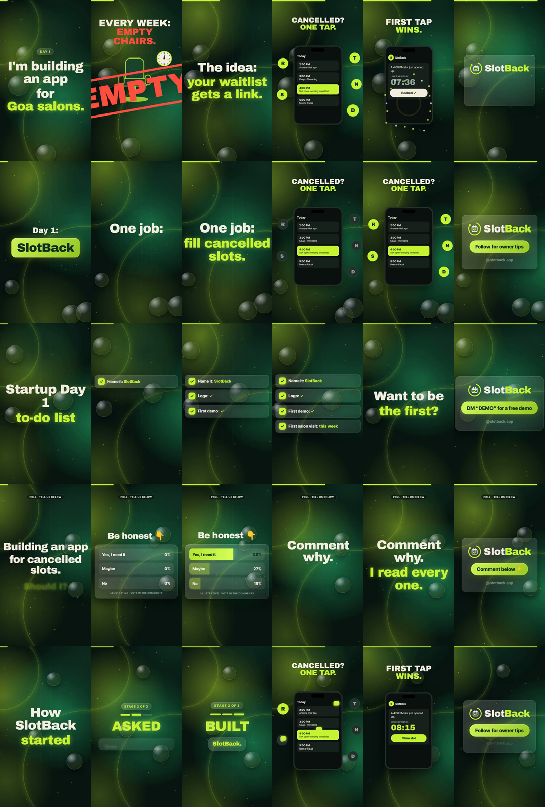

| # | Angle | Title | Length | CTA | Preview |
| --- | --- | --- | --- | --- | --- |
| v1 | story | [Building for Goa salons: Day 1](SCRIPTS.md#p87-v1-building-for-goa-salons-day-1) | 17.1s | Follow for owner tips | [mp4](previews/p87-v1-building-for-goa-salons-day-1.mp4) |
| v2 | quickfire | [Day 1 in 10 seconds](SCRIPTS.md#p87-v2-day-1-in-10-seconds) | 13.3s | Follow for owner tips | [mp4](previews/p87-v2-day-1-in-10-seconds.mp4) |
| v3 | checklist | [Day 1 to-do list](SCRIPTS.md#p87-v3-day-1-to-do-list) | 13.3s | DM “DEMO” for a free demo | [mp4](previews/p87-v3-day-1-to-do-list.mp4) |
| v4 | poll | [Should I build this?](SCRIPTS.md#p87-v4-should-i-build-this) | 13.3s | Comment below 👇 | [mp4](previews/p87-v4-should-i-build-this.mp4) |
| v5 | stages | [From idea to Day 1](SCRIPTS.md#p87-v5-from-idea-to-day-1) | 14.4s | Follow for owner tips | [mp4](previews/p87-v5-from-idea-to-day-1.mp4) |

## 88 · Why I built SlotBack

| # | Angle | Title | Length | CTA | Preview |
| --- | --- | --- | --- | --- | --- |
| v1 | story | [Why I built SlotBack](SCRIPTS.md#p88-v1-why-i-built-slotback) | 17.1s | Follow for owner tips | [mp4](previews/p88-v1-why-i-built-slotback.mp4) |
| v2 | quickfire | [The why, fast](SCRIPTS.md#p88-v2-the-why-fast) | 13.3s | Follow for owner tips | [mp4](previews/p88-v2-the-why-fast.mp4) |
| v3 | versus | [The gap I saw](SCRIPTS.md#p88-v3-the-gap-i-saw) | 14.9s | Follow for owner tips | [mp4](previews/p88-v3-the-gap-i-saw.mp4) |
| v4 | numbers | [The maths that convinced me](SCRIPTS.md#p88-v4-the-maths-that-convinced-me) | 13.3s | Follow for owner tips | [mp4](previews/p88-v4-the-maths-that-convinced-me.mp4) |
| v5 | checklist | [What SlotBack had to be](SCRIPTS.md#p88-v5-what-slotback-had-to-be) | 13.3s | DM “DEMO” for a free demo | [mp4](previews/p88-v5-what-slotback-had-to-be.mp4) |

## 89 · Asking 15 Goa owners about cancellations

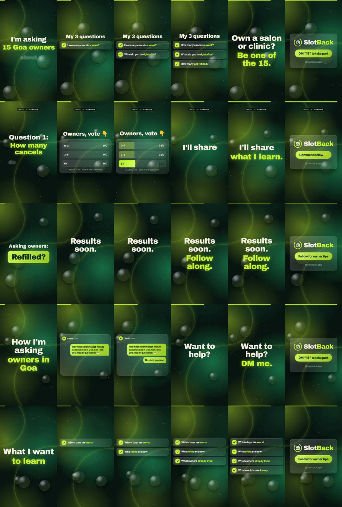

| # | Angle | Title | Length | CTA | Preview |
| --- | --- | --- | --- | --- | --- |
| v1 | story | [I'm asking 15 Goa owners](SCRIPTS.md#p89-v1-i-m-asking-15-goa-owners) | 13.3s | DM “15” to take part | [mp4](previews/p89-v1-i-m-asking-15-goa-owners.mp4) |
| v2 | poll | [Answer question 1](SCRIPTS.md#p89-v2-answer-question-1) | 13.3s | Comment below 👇 | [mp4](previews/p89-v2-answer-question-1.mp4) |
| v3 | quickfire | [3 questions, 15 owners](SCRIPTS.md#p89-v3-3-questions-15-owners) | 13.3s | Follow for owner tips | [mp4](previews/p89-v3-3-questions-15-owners.mp4) |
| v4 | chat | [How I'm asking](SCRIPTS.md#p89-v4-how-i-m-asking) | 13.3s | DM “15” to take part | [mp4](previews/p89-v4-how-i-m-asking.mp4) |
| v5 | checklist | [What I want to learn](SCRIPTS.md#p89-v5-what-i-want-to-learn) | 13.3s | Follow for owner tips | [mp4](previews/p89-v5-what-i-want-to-learn.mp4) |

## 90 · Things I got wrong building SlotBack

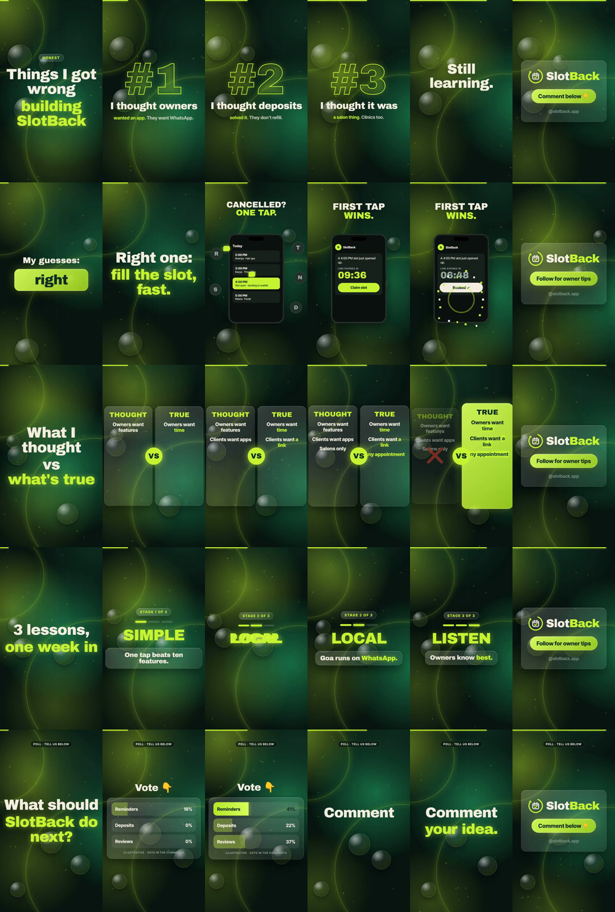

| # | Angle | Title | Length | CTA | Preview |
| --- | --- | --- | --- | --- | --- |
| v1 | list | [Things I got wrong](SCRIPTS.md#p90-v1-things-i-got-wrong) | 13.3s | Comment below 👇 | [mp4](previews/p90-v1-things-i-got-wrong.mp4) |
| v2 | quickfire | [Wrong, wrong, right](SCRIPTS.md#p90-v2-wrong-wrong-right) | 13.3s | Follow for owner tips | [mp4](previews/p90-v2-wrong-wrong-right.mp4) |
| v3 | versus | [What I thought vs what's true](SCRIPTS.md#p90-v3-what-i-thought-vs-what-s-true) | 13.3s | Follow for owner tips | [mp4](previews/p90-v3-what-i-thought-vs-what-s-true.mp4) |
| v4 | stages | [Lessons, one by one](SCRIPTS.md#p90-v4-lessons-one-by-one) | 13.3s | Follow for owner tips | [mp4](previews/p90-v4-lessons-one-by-one.mp4) |
| v5 | poll | [What should I build next?](SCRIPTS.md#p90-v5-what-should-i-build-next) | 13.3s | Comment below 👇 | [mp4](previews/p90-v5-what-should-i-build-next.mp4) |

## 91 · Visiting salons in Panaji to show a demo

| # | Angle | Title | Length | CTA | Preview |
| --- | --- | --- | --- | --- | --- |
| v1 | story | [Showing demos in Panaji](SCRIPTS.md#p91-v1-showing-demos-in-panaji) | 13.3s | DM “DEMO” for a free demo | [mp4](previews/p91-v1-showing-demos-in-panaji.mp4) |
| v2 | quickfire | [Demo day route](SCRIPTS.md#p91-v2-demo-day-route) | 13.3s | DM “DEMO” for a free demo | [mp4](previews/p91-v2-demo-day-route.mp4) |
| v3 | checklist | [What a demo looks like](SCRIPTS.md#p91-v3-what-a-demo-looks-like) | 13.3s | DM “DEMO” for a free demo | [mp4](previews/p91-v3-what-a-demo-looks-like.mp4) |
| v4 | chat | [Book a demo visit](SCRIPTS.md#p91-v4-book-a-demo-visit) | 13.3s | DM “DEMO” for a free demo | [mp4](previews/p91-v4-book-a-demo-visit.mp4) |
| v5 | poll | [Which area next?](SCRIPTS.md#p91-v5-which-area-next) | 13.3s | Comment below 👇 | [mp4](previews/p91-v5-which-area-next.mp4) |

## 92 · A day building a startup in Goa

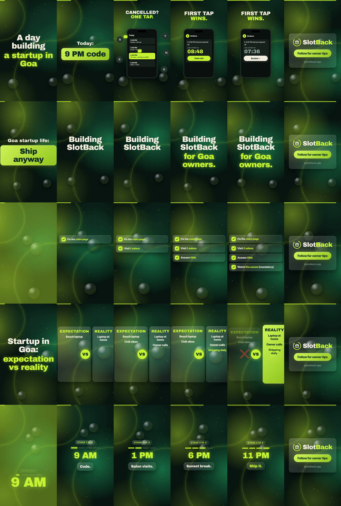

| # | Angle | Title | Length | CTA | Preview |
| --- | --- | --- | --- | --- | --- |
| v1 | story | [A day building a startup in Goa](SCRIPTS.md#p92-v1-a-day-building-a-startup-in-goa) | 13.3s | Follow for owner tips | [mp4](previews/p92-v1-a-day-building-a-startup-in-goa.mp4) |
| v2 | quickfire | [Startup life, Goa edition](SCRIPTS.md#p92-v2-startup-life-goa-edition) | 13.3s | Follow for owner tips | [mp4](previews/p92-v2-startup-life-goa-edition.mp4) |
| v3 | checklist | [Today's to-do](SCRIPTS.md#p92-v3-today-s-to-do) | 13.3s | Follow for owner tips | [mp4](previews/p92-v3-today-s-to-do.mp4) |
| v4 | versus | [Expectation vs reality](SCRIPTS.md#p92-v4-expectation-vs-reality) | 13.3s | Follow for owner tips | [mp4](previews/p92-v4-expectation-vs-reality.mp4) |
| v5 | stages | [Morning to midnight](SCRIPTS.md#p92-v5-morning-to-midnight) | 13.3s | Follow for owner tips | [mp4](previews/p92-v5-morning-to-midnight.mp4) |

## 93 · You asked: is SlotBack free?

| # | Angle | Title | Length | CTA | Preview |
| --- | --- | --- | --- | --- | --- |
| v1 | chat | [Is SlotBack free?](SCRIPTS.md#p93-v1-is-slotback-free) | 13.3s | DM “DEMO” for a free demo | [mp4](previews/p93-v1-is-slotback-free.mp4) |
| v2 | quickfire | [Free demo, no catch](SCRIPTS.md#p93-v2-free-demo-no-catch) | 13.3s | DM “DEMO” for a free demo | [mp4](previews/p93-v2-free-demo-no-catch.mp4) |
| v3 | numbers | [Cost vs what it saves](SCRIPTS.md#p93-v3-cost-vs-what-it-saves) | 13.3s | DM “DEMO” for a free demo | [mp4](previews/p93-v3-cost-vs-what-it-saves.mp4) |
| v4 | checklist | [What's free](SCRIPTS.md#p93-v4-what-s-free) | 13.3s | DM “DEMO” for a free demo | [mp4](previews/p93-v4-what-s-free.mp4) |
| v5 | poll | [What would you pay?](SCRIPTS.md#p93-v5-what-would-you-pay) | 13.3s | Comment below 👇 | [mp4](previews/p93-v5-what-would-you-pay.mp4) |

## 95 · Panaji vs Margao: who cancels more?

| # | Angle | Title | Length | CTA | Preview |
| --- | --- | --- | --- | --- | --- |
| v1 | poll | [Panaji vs Margao: who cancels more?](SCRIPTS.md#p95-v1-panaji-vs-margao-who-cancels-more) | 14.4s | Comment below 👇 | [mp4](previews/p95-v1-panaji-vs-margao-who-cancels-more.mp4) |
| v2 | versus | [Panaji excuses vs Margao excuses](SCRIPTS.md#p95-v2-panaji-excuses-vs-margao-excuses) | 13.3s | Comment below 👇 | [mp4](previews/p95-v2-panaji-excuses-vs-margao-excuses.mp4) |
| v3 | quickfire | [Goa city cancel ranking](SCRIPTS.md#p95-v3-goa-city-cancel-ranking) | 13.3s | Comment below 👇 | [mp4](previews/p95-v3-goa-city-cancel-ranking.mp4) |
| v4 | rank | [Ranking Goa cities by excuses](SCRIPTS.md#p95-v4-ranking-goa-cities-by-excuses) | 13.3s | Comment below 👇 | [mp4](previews/p95-v4-ranking-goa-cities-by-excuses.mp4) |
| v5 | chat | [Group chat argument](SCRIPTS.md#p95-v5-group-chat-argument) | 13.9s | Comment below 👇 | [mp4](previews/p95-v5-group-chat-argument.mp4) |

## 96 · Goa's best salon streets (and their empty 4 PMs)

| # | Angle | Title | Length | CTA | Preview |
| --- | --- | --- | --- | --- | --- |
| v1 | story | [Goa's salon streets at 4 PM](SCRIPTS.md#p96-v1-goa-s-salon-streets-at-4-pm) | 13.3s | DM “DEMO” for a free demo | [mp4](previews/p96-v1-goa-s-salon-streets-at-4-pm.mp4) |
| v2 | quickfire | [Salon street tour](SCRIPTS.md#p96-v2-salon-street-tour) | 13.3s | Comment below 👇 | [mp4](previews/p96-v2-salon-street-tour.mp4) |
| v3 | poll | [Best salon area in Goa?](SCRIPTS.md#p96-v3-best-salon-area-in-goa) | 13.3s | Comment below 👇 | [mp4](previews/p96-v3-best-salon-area-in-goa.mp4) |
| v4 | checklist | [On every salon street](SCRIPTS.md#p96-v4-on-every-salon-street) | 13.3s | DM “DEMO” for a free demo | [mp4](previews/p96-v4-on-every-salon-street.mp4) |
| v5 | numbers | [One street, one week of gaps](SCRIPTS.md#p96-v5-one-street-one-week-of-gaps) | 13.3s | DM “DEMO” for a free demo | [mp4](previews/p96-v5-one-street-one-week-of-gaps.mp4) |

## 97 · Susegad time vs appointment time

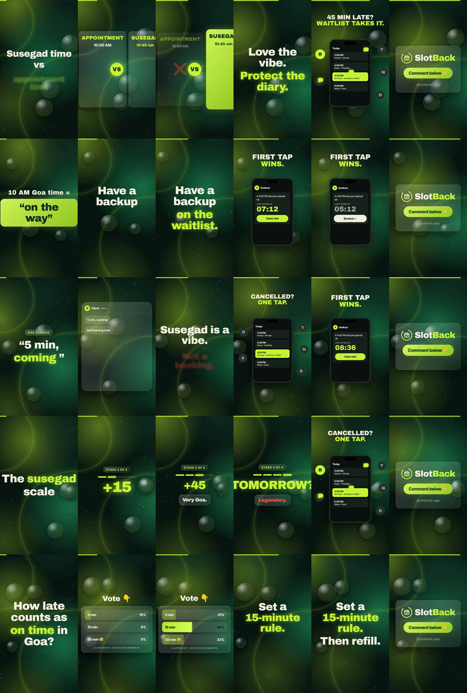

| # | Angle | Title | Length | CTA | Preview |
| --- | --- | --- | --- | --- | --- |
| v1 | versus | [Susegad time vs appointment time](SCRIPTS.md#p97-v1-susegad-time-vs-appointment-time) | 13.3s | Comment below 👇 | [mp4](previews/p97-v1-susegad-time-vs-appointment-time.mp4) |
| v2 | quickfire | [10 AM Goa time](SCRIPTS.md#p97-v2-10-am-goa-time) | 13.3s | Comment below 👇 | [mp4](previews/p97-v2-10-am-goa-time.mp4) |
| v3 | chat | [“5 min, coming”](SCRIPTS.md#p97-v3-5-min-coming) | 15.5s | Comment below 👇 | [mp4](previews/p97-v3-5-min-coming.mp4) |
| v4 | stages | [The susegad scale](SCRIPTS.md#p97-v4-the-susegad-scale) | 13.3s | Comment below 👇 | [mp4](previews/p97-v4-the-susegad-scale.mp4) |
| v5 | poll | [How late is “on time” in Goa?](SCRIPTS.md#p97-v5-how-late-is-on-time-in-goa) | 13.3s | Comment below 👇 | [mp4](previews/p97-v5-how-late-is-on-time-in-goa.mp4) |

## 98 · Tourist season = last-minute bookings

| # | Angle | Title | Length | CTA | Preview |
| --- | --- | --- | --- | --- | --- |
| v1 | story | [Tourist season = last-minute bookings](SCRIPTS.md#p98-v1-tourist-season-last-minute-bookings) | 16.0s | DM “DEMO” for a free demo | [mp4](previews/p98-v1-tourist-season-last-minute-bookings.mp4) |
| v2 | checklist | [Get ready for Nov–Feb](SCRIPTS.md#p98-v2-get-ready-for-nov-feb) | 13.3s | Save this for your next cancel | [mp4](previews/p98-v2-get-ready-for-nov-feb.mp4) |
| v3 | numbers | [Tourists want today](SCRIPTS.md#p98-v3-tourists-want-today) | 14.9s | DM “DEMO” for a free demo | [mp4](previews/p98-v3-tourists-want-today.mp4) |
| v4 | versus | [Locals vs tourists](SCRIPTS.md#p98-v4-locals-vs-tourists) | 13.3s | DM “DEMO” for a free demo | [mp4](previews/p98-v4-locals-vs-tourists.mp4) |
| v5 | quickfire | [Season mode: on](SCRIPTS.md#p98-v5-season-mode-on) | 13.3s | DM “DEMO” for a free demo | [mp4](previews/p98-v5-season-mode-on.mp4) |

## 99 · Shout-out to Goa's hardest-working owners

| # | Angle | Title | Length | CTA | Preview |
| --- | --- | --- | --- | --- | --- |
| v1 | story | [To Goa's hardest-working owners](SCRIPTS.md#p99-v1-to-goa-s-hardest-working-owners) | 13.3s | Send this to an owner | [mp4](previews/p99-v1-to-goa-s-hardest-working-owners.mp4) |
| v2 | quickfire | [Tag an owner who never stops](SCRIPTS.md#p99-v2-tag-an-owner-who-never-stops) | 13.3s | Tag an owner below 👇 | [mp4](previews/p99-v2-tag-an-owner-who-never-stops.mp4) |
| v3 | checklist | [Things owners do nobody sees](SCRIPTS.md#p99-v3-things-owners-do-nobody-sees) | 13.3s | Send this to an owner | [mp4](previews/p99-v3-things-owners-do-nobody-sees.mp4) |
| v4 | chat | [A message for owners](SCRIPTS.md#p99-v4-a-message-for-owners) | 13.3s | Send this to an owner | [mp4](previews/p99-v4-a-message-for-owners.mp4) |
| v5 | poll | [Hardest part of owning a salon?](SCRIPTS.md#p99-v5-hardest-part-of-owning-a-salon) | 13.3s | Comment below 👇 | [mp4](previews/p99-v5-hardest-part-of-owning-a-salon.mp4) |

## 100 · Konkani phrase of the day: ‘cancel zalem’

| # | Angle | Title | Length | CTA | Preview |
| --- | --- | --- | --- | --- | --- |
| v1 | story | [Konkani phrase of the day](SCRIPTS.md#p100-v1-konkani-phrase-of-the-day) | 14.4s | Comment below 👇 | [mp4](previews/p100-v1-konkani-phrase-of-the-day.mp4) |
| v2 | quickfire | [Cancel zalem → refill zalem](SCRIPTS.md#p100-v2-cancel-zalem-refill-zalem) | 13.3s | Comment below 👇 | [mp4](previews/p100-v2-cancel-zalem-refill-zalem.mp4) |
| v3 | chat | [“Cancel zalem” in the wild](SCRIPTS.md#p100-v3-cancel-zalem-in-the-wild) | 13.3s | Comment below 👇 | [mp4](previews/p100-v3-cancel-zalem-in-the-wild.mp4) |
| v4 | poll | [Your favourite Konkani owner phrase?](SCRIPTS.md#p100-v4-your-favourite-konkani-owner-phrase) | 13.3s | Comment below 👇 | [mp4](previews/p100-v4-your-favourite-konkani-owner-phrase.mp4) |
| v5 | stages | [From cancel zalem to refill zalem](SCRIPTS.md#p100-v5-from-cancel-zalem-to-refill-zalem) | 13.3s | DM “DEMO” for a free demo | [mp4](previews/p100-v5-from-cancel-zalem-to-refill-zalem.mp4) |

## 101 · Rain, traffic, fish curry nap: Goa reasons

| # | Angle | Title | Length | CTA | Preview |
| --- | --- | --- | --- | --- | --- |
| v1 | rank | [Goa cancellation reasons, ranked](SCRIPTS.md#p101-v1-goa-cancellation-reasons-ranked) | 18.7s | Comment below 👇 | [mp4](previews/p101-v1-goa-cancellation-reasons-ranked.mp4) |
| v2 | pack | [Goa cancel bingo](SCRIPTS.md#p101-v2-goa-cancel-bingo) | 13.3s | Comment below 👇 | [mp4](previews/p101-v2-goa-cancel-bingo.mp4) |
| v3 | quickfire | [Reasons in 5 seconds](SCRIPTS.md#p101-v3-reasons-in-5-seconds) | 13.3s | Comment below 👇 | [mp4](previews/p101-v3-reasons-in-5-seconds.mp4) |
| v4 | poll | [Most Goan excuse?](SCRIPTS.md#p101-v4-most-goan-excuse) | 13.3s | Comment below 👇 | [mp4](previews/p101-v4-most-goan-excuse.mp4) |
| v5 | chat | [The fish curry nap](SCRIPTS.md#p101-v5-the-fish-curry-nap) | 14.4s | Comment below 👇 | [mp4](previews/p101-v5-the-fish-curry-nap.mp4) |

## 102 · Every Goa owner knows this WhatsApp: ‘bhai aaj nahi’

| # | Angle | Title | Length | CTA | Preview |
| --- | --- | --- | --- | --- | --- |
| v1 | chat | [“Bhai aaj nahi”](SCRIPTS.md#p102-v1-bhai-aaj-nahi) | 14.4s | Comment below 👇 | [mp4](previews/p102-v1-bhai-aaj-nahi.mp4) |
| v2 | quickfire | [Aaj nahi, kal pakka](SCRIPTS.md#p102-v2-aaj-nahi-kal-pakka) | 13.3s | Comment below 👇 | [mp4](previews/p102-v2-aaj-nahi-kal-pakka.mp4) |
| v3 | stages | [The ‘kal pakka’ journey](SCRIPTS.md#p102-v3-the-kal-pakka-journey) | 14.4s | Comment below 👇 | [mp4](previews/p102-v3-the-kal-pakka-journey.mp4) |
| v4 | poll | [How often is it really ‘kal pakka’?](SCRIPTS.md#p102-v4-how-often-is-it-really-kal-pakka) | 13.3s | Comment below 👇 | [mp4](previews/p102-v4-how-often-is-it-really-kal-pakka.mp4) |
| v5 | versus | [Wait for kal vs refill aaj](SCRIPTS.md#p102-v5-wait-for-kal-vs-refill-aaj) | 13.3s | DM “DEMO” for a free demo | [mp4](previews/p102-v5-wait-for-kal-vs-refill-aaj.mp4) |

## 103 · Reacting to ‘just take deposits bro’

| # | Angle | Title | Length | CTA | Preview |
| --- | --- | --- | --- | --- | --- |
| v1 | story | [“Just take deposits bro”](SCRIPTS.md#p103-v1-just-take-deposits-bro) | 14.9s | Comment below 👇 | [mp4](previews/p103-v1-just-take-deposits-bro.mp4) |
| v2 | quickfire | [Advice I get, ranked](SCRIPTS.md#p103-v2-advice-i-get-ranked) | 13.3s | Comment below 👇 | [mp4](previews/p103-v2-advice-i-get-ranked.mp4) |
| v3 | rank | [Rating bad business advice](SCRIPTS.md#p103-v3-rating-bad-business-advice) | 13.3s | Comment below 👇 | [mp4](previews/p103-v3-rating-bad-business-advice.mp4) |
| v4 | versus | [Deposit guy vs waitlist guy](SCRIPTS.md#p103-v4-deposit-guy-vs-waitlist-guy) | 13.3s | Comment below 👇 | [mp4](previews/p103-v4-deposit-guy-vs-waitlist-guy.mp4) |
| v5 | chat | [The deposit debate](SCRIPTS.md#p103-v5-the-deposit-debate) | 13.9s | Comment below 👇 | [mp4](previews/p103-v5-the-deposit-debate.mp4) |

## 104 · This or that: owner edition

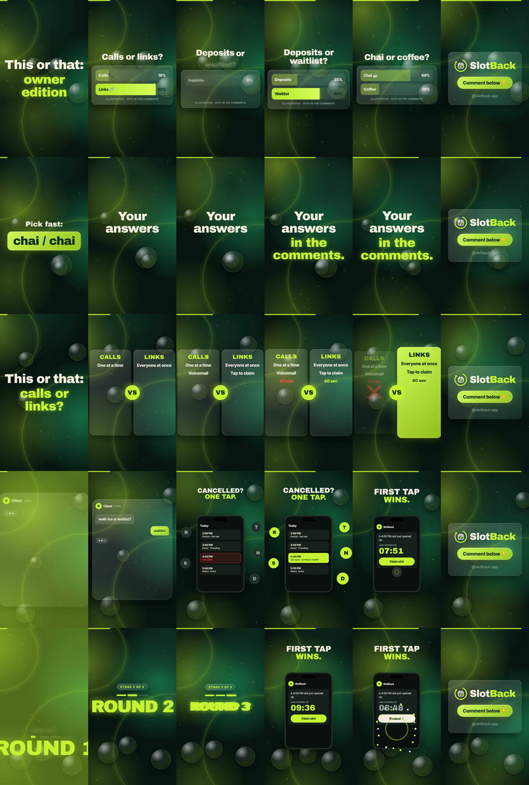

| # | Angle | Title | Length | CTA | Preview |
| --- | --- | --- | --- | --- | --- |
| v1 | poll | [This or that: owner edition](SCRIPTS.md#p104-v1-this-or-that-owner-edition) | 13.3s | Comment below 👇 | [mp4](previews/p104-v1-this-or-that-owner-edition.mp4) |
| v2 | quickfire | [Rapid this or that](SCRIPTS.md#p104-v2-rapid-this-or-that) | 13.3s | Comment below 👇 | [mp4](previews/p104-v2-rapid-this-or-that.mp4) |
| v3 | versus | [Calls or links?](SCRIPTS.md#p104-v3-calls-or-links) | 13.3s | Comment below 👇 | [mp4](previews/p104-v3-calls-or-links.mp4) |
| v4 | chat | [Owner this-or-that](SCRIPTS.md#p104-v4-owner-this-or-that) | 13.3s | Comment below 👇 | [mp4](previews/p104-v4-owner-this-or-that.mp4) |
| v5 | stages | [This or that, round by round](SCRIPTS.md#p104-v5-this-or-that-round-by-round) | 13.3s | Comment below 👇 | [mp4](previews/p104-v5-this-or-that-round-by-round.mp4) |

## 105 · Things that just make sense

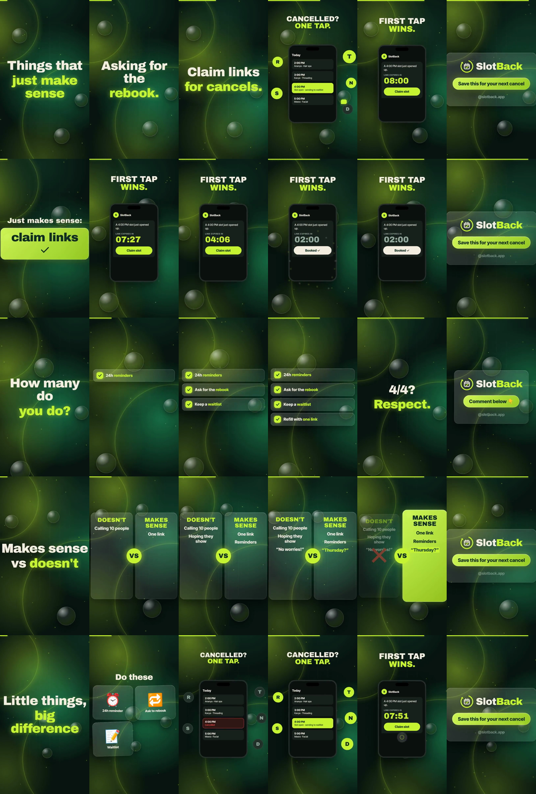

| # | Angle | Title | Length | CTA | Preview |
| --- | --- | --- | --- | --- | --- |
| v1 | list | [Things that just make sense](SCRIPTS.md#p105-v1-things-that-just-make-sense) | 13.9s | Save this for your next cancel | [mp4](previews/p105-v1-things-that-just-make-sense.mp4) |
| v2 | quickfire | [Makes sense ✓](SCRIPTS.md#p105-v2-makes-sense) | 13.3s | Save this for your next cancel | [mp4](previews/p105-v2-makes-sense.mp4) |
| v3 | checklist | [Makes-sense checklist](SCRIPTS.md#p105-v3-makes-sense-checklist) | 13.3s | Comment below 👇 | [mp4](previews/p105-v3-makes-sense-checklist.mp4) |
| v4 | versus | [Makes sense vs doesn't](SCRIPTS.md#p105-v4-makes-sense-vs-doesn-t) | 13.3s | Save this for your next cancel | [mp4](previews/p105-v4-makes-sense-vs-doesn-t.mp4) |
| v5 | pack | [Little things, big difference](SCRIPTS.md#p105-v5-little-things-big-difference) | 13.3s | Save this for your next cancel | [mp4](previews/p105-v5-little-things-big-difference.mp4) |

## 106 · Expectation vs reality: Saturday diary

| # | Angle | Title | Length | CTA | Preview |
| --- | --- | --- | --- | --- | --- |
| v1 | versus | [Saturday: expectation vs reality](SCRIPTS.md#p106-v1-saturday-expectation-vs-reality) | 15.5s | Comment below 👇 | [mp4](previews/p106-v1-saturday-expectation-vs-reality.mp4) |
| v2 | story | [Saturday, hour by hour](SCRIPTS.md#p106-v2-saturday-hour-by-hour) | 13.3s | DM “DEMO” for a free demo | [mp4](previews/p106-v2-saturday-hour-by-hour.mp4) |
| v3 | quickfire | [Saturday mood swings](SCRIPTS.md#p106-v3-saturday-mood-swings) | 13.3s | DM “DEMO” for a free demo | [mp4](previews/p106-v3-saturday-mood-swings.mp4) |
| v4 | numbers | [Saturday gaps, priced](SCRIPTS.md#p106-v4-saturday-gaps-priced) | 13.3s | DM “DEMO” for a free demo | [mp4](previews/p106-v4-saturday-gaps-priced.mp4) |
| v5 | poll | [How many gaps last Saturday?](SCRIPTS.md#p106-v5-how-many-gaps-last-saturday) | 13.3s | Comment below 👇 | [mp4](previews/p106-v5-how-many-gaps-last-saturday.mp4) |

## 107 · Get ready with me (to lose ₹2,000 at 4 PM)

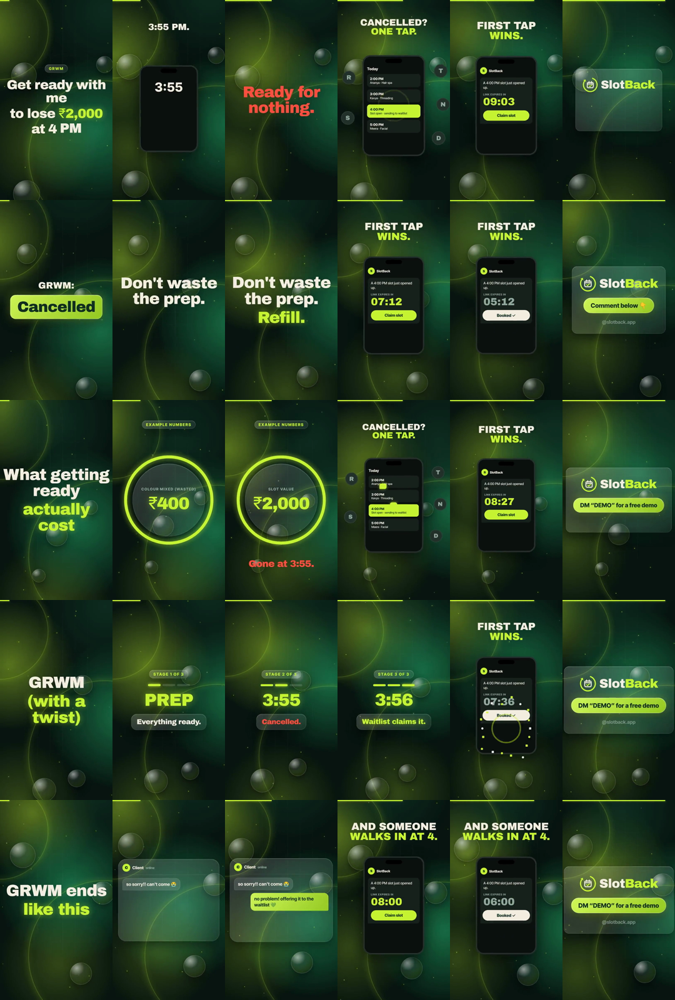

| # | Angle | Title | Length | CTA | Preview |
| --- | --- | --- | --- | --- | --- |
| v1 | story | [GRWM to lose ₹2,000 at 4 PM](SCRIPTS.md#p107-v1-grwm-to-lose-2-000-at-4-pm) | 16.5s | Comment below 👇 | [mp4](previews/p107-v1-grwm-to-lose-2-000-at-4-pm.mp4) |
| v2 | quickfire | [GRWM speedrun](SCRIPTS.md#p107-v2-grwm-speedrun) | 13.3s | Comment below 👇 | [mp4](previews/p107-v2-grwm-speedrun.mp4) |
| v3 | numbers | [What the prep cost](SCRIPTS.md#p107-v3-what-the-prep-cost) | 14.9s | DM “DEMO” for a free demo | [mp4](previews/p107-v3-what-the-prep-cost.mp4) |
| v4 | stages | [GRWM: the twist](SCRIPTS.md#p107-v4-grwm-the-twist) | 13.3s | DM “DEMO” for a free demo | [mp4](previews/p107-v4-grwm-the-twist.mp4) |
| v5 | chat | [The 3:55 GRWM ending](SCRIPTS.md#p107-v5-the-3-55-grwm-ending) | 13.3s | DM “DEMO” for a free demo | [mp4](previews/p107-v5-the-3-55-grwm-ending.mp4) |

## 108 · Starter pack: salon owner

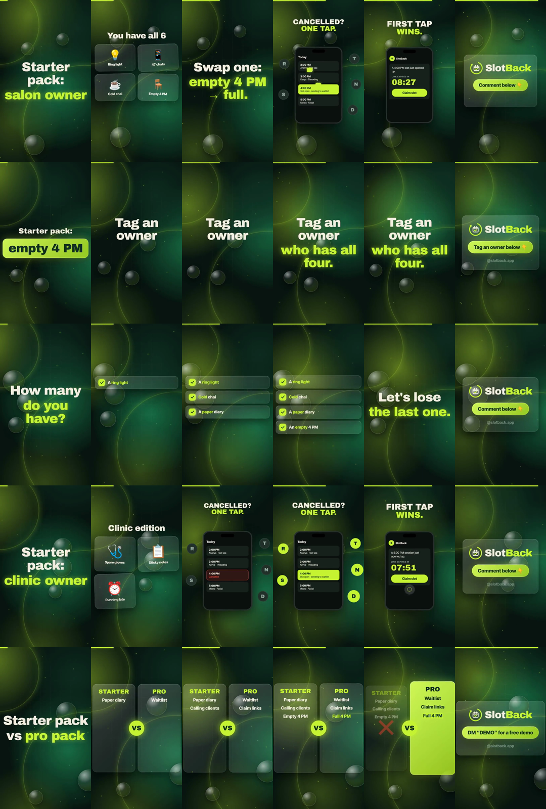

| # | Angle | Title | Length | CTA | Preview |
| --- | --- | --- | --- | --- | --- |
| v1 | pack | [Salon owner starter pack](SCRIPTS.md#p108-v1-salon-owner-starter-pack) | 14.9s | Comment below 👇 | [mp4](previews/p108-v1-salon-owner-starter-pack.mp4) |
| v2 | quickfire | [Starter pack items](SCRIPTS.md#p108-v2-starter-pack-items) | 13.3s | Tag an owner below 👇 | [mp4](previews/p108-v2-starter-pack-items.mp4) |
| v3 | checklist | [Check your starter pack](SCRIPTS.md#p108-v3-check-your-starter-pack) | 13.3s | Comment below 👇 | [mp4](previews/p108-v3-check-your-starter-pack.mp4) |
| v4 | pack | [Clinic owner starter pack](SCRIPTS.md#p108-v4-clinic-owner-starter-pack) | 13.3s | Comment below 👇 | [mp4](previews/p108-v4-clinic-owner-starter-pack.mp4) |
| v5 | versus | [Starter pack vs pro pack](SCRIPTS.md#p108-v5-starter-pack-vs-pro-pack) | 13.3s | DM “DEMO” for a free demo | [mp4](previews/p108-v5-starter-pack-vs-pro-pack.mp4) |

## 109 · Duet this if you had a no-show this week

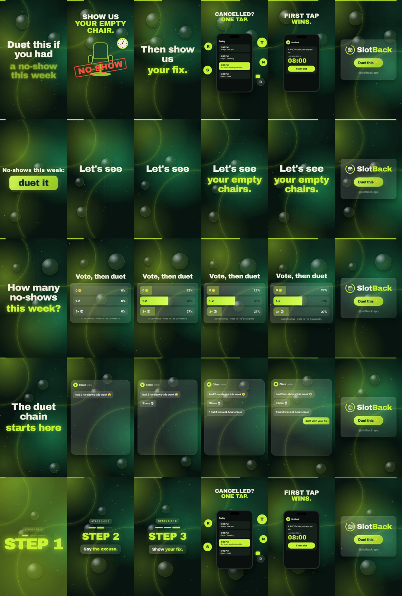

| # | Angle | Title | Length | CTA | Preview |
| --- | --- | --- | --- | --- | --- |
| v1 | story | [Duet this if you had a no-show](SCRIPTS.md#p109-v1-duet-this-if-you-had-a-no-show) | 13.9s | Duet this 👇 | [mp4](previews/p109-v1-duet-this-if-you-had-a-no-show.mp4) |
| v2 | quickfire | [No-show this week?](SCRIPTS.md#p109-v2-no-show-this-week) | 13.3s | Duet this 👇 | [mp4](previews/p109-v2-no-show-this-week.mp4) |
| v3 | poll | [No-shows this week?](SCRIPTS.md#p109-v3-no-shows-this-week) | 13.3s | Duet this 👇 | [mp4](previews/p109-v3-no-shows-this-week.mp4) |
| v4 | chat | [Duet chain](SCRIPTS.md#p109-v4-duet-chain) | 13.3s | Duet this 👇 | [mp4](previews/p109-v4-duet-chain.mp4) |
| v5 | stages | [Duet challenge](SCRIPTS.md#p109-v5-duet-challenge) | 13.9s | Duet this 👇 | [mp4](previews/p109-v5-duet-challenge.mp4) |

## 110 · Can we fill this slot before the song ends?

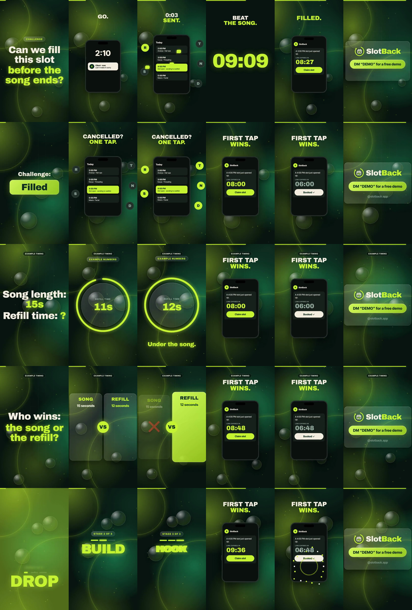

| # | Angle | Title | Length | CTA | Preview |
| --- | --- | --- | --- | --- | --- |
| v1 | demo | [Fill this slot before the song ends](SCRIPTS.md#p110-v1-fill-this-slot-before-the-song-ends) | 14.9s | DM “DEMO” for a free demo | [mp4](previews/p110-v1-fill-this-slot-before-the-song-ends.mp4) |
| v2 | quickfire | [15-second refill challenge](SCRIPTS.md#p110-v2-15-second-refill-challenge) | 13.3s | DM “DEMO” for a free demo | [mp4](previews/p110-v2-15-second-refill-challenge.mp4) |
| v3 | numbers | [Song: 15s. Refill: ?](SCRIPTS.md#p110-v3-song-15s-refill) | 13.3s | DM “DEMO” for a free demo | [mp4](previews/p110-v3-song-15s-refill.mp4) |
| v4 | versus | [Song vs refill](SCRIPTS.md#p110-v4-song-vs-refill) | 13.3s | DM “DEMO” for a free demo | [mp4](previews/p110-v4-song-vs-refill.mp4) |
| v5 | stages | [Race the beat](SCRIPTS.md#p110-v5-race-the-beat) | 13.3s | DM “DEMO” for a free demo | [mp4](previews/p110-v5-race-the-beat.mp4) |

## C1 · A barber's worst Tuesday

| # | Angle | Title | Length | CTA | Preview |
| --- | --- | --- | --- | --- | --- |
| v1 | story | [A barber's worst Tuesday](SCRIPTS.md#pC1-v1-a-barber-s-worst-tuesday) | 18.1s | Send this to an owner | [mp4](previews/pC1-v1-a-barber-s-worst-tuesday.mp4) |
| v2 | quickfire | [Tuesday, cancel by cancel](SCRIPTS.md#pC1-v2-tuesday-cancel-by-cancel) | 13.3s | DM “DEMO” for a free demo | [mp4](previews/pC1-v2-tuesday-cancel-by-cancel.mp4) |
| v3 | numbers | [The worst Tuesday, priced](SCRIPTS.md#pC1-v3-the-worst-tuesday-priced) | 13.3s | DM “DEMO” for a free demo | [mp4](previews/pC1-v3-the-worst-tuesday-priced.mp4) |
| v4 | chat | [The barber's Tuesday DMs](SCRIPTS.md#pC1-v4-the-barber-s-tuesday-dms) | 13.3s | Send this to an owner | [mp4](previews/pC1-v4-the-barber-s-tuesday-dms.mp4) |
| v5 | stages | [Barber Tuesday stages](SCRIPTS.md#pC1-v5-barber-tuesday-stages) | 13.3s | DM “DEMO” for a free demo | [mp4](previews/pC1-v5-barber-tuesday-stages.mp4) |

## C2 · Your bookings happen at 11 PM

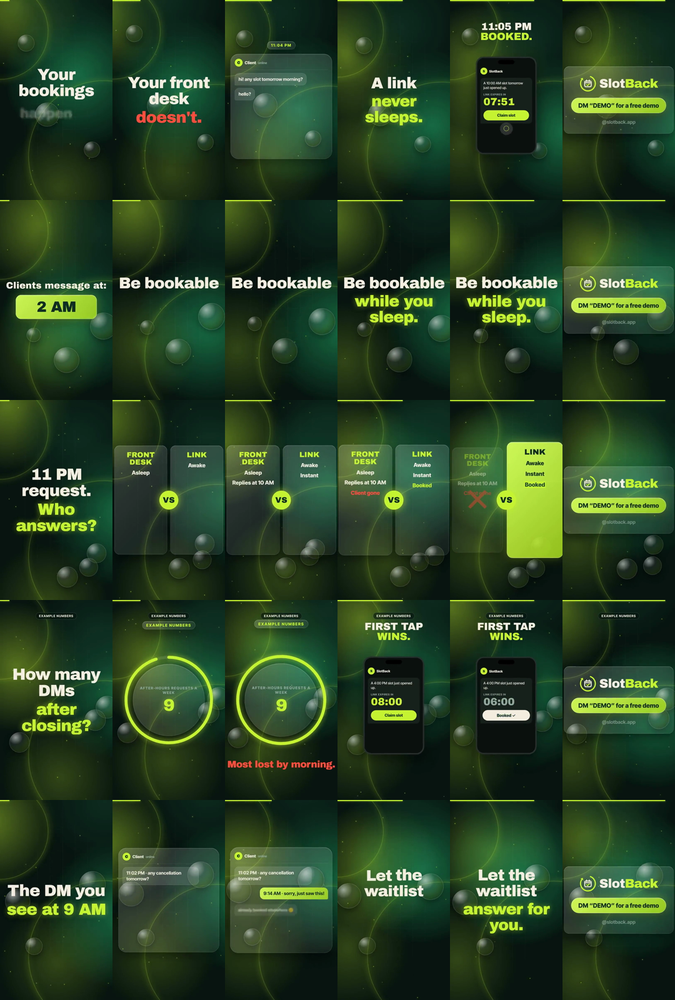

| # | Angle | Title | Length | CTA | Preview |
| --- | --- | --- | --- | --- | --- |
| v1 | story | [Your bookings happen at 11 PM](SCRIPTS.md#pC2-v1-your-bookings-happen-at-11-pm) | 13.3s | DM “DEMO” for a free demo | [mp4](previews/pC2-v1-your-bookings-happen-at-11-pm.mp4) |
| v2 | quickfire | [When clients actually book](SCRIPTS.md#pC2-v2-when-clients-actually-book) | 13.3s | DM “DEMO” for a free demo | [mp4](previews/pC2-v2-when-clients-actually-book.mp4) |
| v3 | versus | [Front desk vs link](SCRIPTS.md#pC2-v3-front-desk-vs-link) | 13.3s | DM “DEMO” for a free demo | [mp4](previews/pC2-v3-front-desk-vs-link.mp4) |
| v4 | numbers | [The after-hours DMs](SCRIPTS.md#pC2-v4-the-after-hours-dms) | 13.3s | DM “DEMO” for a free demo | [mp4](previews/pC2-v4-the-after-hours-dms.mp4) |
| v5 | chat | [The 11 PM DM](SCRIPTS.md#pC2-v5-the-11-pm-dm) | 13.3s | DM “DEMO” for a free demo | [mp4](previews/pC2-v5-the-11-pm-dm.mp4) |

## C3 · Front desk on the phone for 40 minutes

| # | Angle | Title | Length | CTA | Preview |
| --- | --- | --- | --- | --- | --- |
| v1 | story | [Front desk on the phone for 40 minutes](SCRIPTS.md#pC3-v1-front-desk-on-the-phone-for-40-minut) | 17.1s | DM “DEMO” for a free demo | [mp4](previews/pC3-v1-front-desk-on-the-phone-for-40-minut.mp4) |
| v2 | numbers | [40 minutes, priced](SCRIPTS.md#pC3-v2-40-minutes-priced) | 15.5s | DM “DEMO” for a free demo | [mp4](previews/pC3-v2-40-minutes-priced.mp4) |
| v3 | quickfire | [Ring ring ring](SCRIPTS.md#pC3-v3-ring-ring-ring) | 13.3s | DM “DEMO” for a free demo | [mp4](previews/pC3-v3-ring-ring-ring.mp4) |
| v4 | versus | [Receptionist: before vs after](SCRIPTS.md#pC3-v4-receptionist-before-vs-after) | 13.3s | DM “DEMO” for a free demo | [mp4](previews/pC3-v4-receptionist-before-vs-after.mp4) |
| v5 | stages | [The 40-minute call marathon](SCRIPTS.md#pC3-v5-the-40-minute-call-marathon) | 15.5s | DM “DEMO” for a free demo | [mp4](previews/pC3-v5-the-40-minute-call-marathon.mp4) |

## C5 · Bring a salon friend

| # | Angle | Title | Length | CTA | Preview |
| --- | --- | --- | --- | --- | --- |
| v1 | story | [Know an owner who needs this?](SCRIPTS.md#pC5-v1-know-an-owner-who-needs-this) | 13.3s | Send this to an owner | [mp4](previews/pC5-v1-know-an-owner-who-needs-this.mp4) |
| v2 | quickfire | [Tag a friend](SCRIPTS.md#pC5-v2-tag-a-friend) | 3.2s | Tag an owner below 👇 | [mp4](previews/pC5-v2-tag-a-friend.mp4) |
| v3 | chat | [Send this to a friend](SCRIPTS.md#pC5-v3-send-this-to-a-friend) | 13.3s | Send this to an owner | [mp4](previews/pC5-v3-send-this-to-a-friend.mp4) |
| v4 | checklist | [Send this to someone who…](SCRIPTS.md#pC5-v4-send-this-to-someone-who) | 13.3s | Send this to an owner | [mp4](previews/pC5-v4-send-this-to-someone-who.mp4) |
| v5 | poll | [Who do you know?](SCRIPTS.md#pC5-v5-who-do-you-know) | 13.3s | Send this to an owner | [mp4](previews/pC5-v5-who-do-you-know.mp4) |

## C7 · Free toolkit for Goa owners

| # | Angle | Title | Length | CTA | Preview |
| --- | --- | --- | --- | --- | --- |
| v1 | demo | [Free toolkit for Goa owners](SCRIPTS.md#pC7-v1-free-toolkit-for-goa-owners) | 13.3s | Free toolkit · link in bio | [mp4](previews/pC7-v1-free-toolkit-for-goa-owners.mp4) |
| v2 | numbers | [Calculator preview](SCRIPTS.md#pC7-v2-calculator-preview) | 13.3s | Free toolkit · link in bio | [mp4](previews/pC7-v2-calculator-preview.mp4) |
| v3 | chat | [Templates preview](SCRIPTS.md#pC7-v3-templates-preview) | 13.3s | Free toolkit · link in bio | [mp4](previews/pC7-v3-templates-preview.mp4) |
| v4 | checklist | [The Monday reset](SCRIPTS.md#pC7-v4-the-monday-reset) | 13.3s | Free toolkit · link in bio | [mp4](previews/pC7-v4-the-monday-reset.mp4) |
| v5 | quickfire | [4 tools, 0 rupees](SCRIPTS.md#pC7-v5-4-tools-0-rupees) | 13.3s | Free toolkit · link in bio | [mp4](previews/pC7-v5-4-tools-0-rupees.mp4) |

## C8 · Owner tip of the week

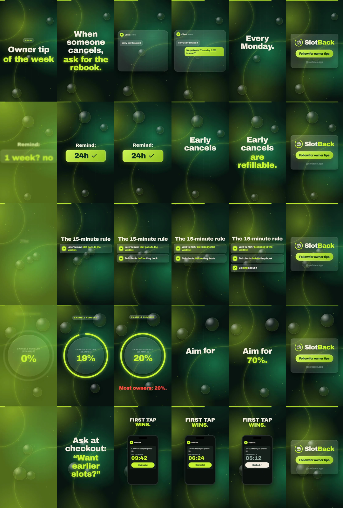

| # | Angle | Title | Length | CTA | Preview |
| --- | --- | --- | --- | --- | --- |
| v1 | list | [Owner tip: ask for the rebook](SCRIPTS.md#pC8-v1-owner-tip-ask-for-the-rebook) | 13.3s | Follow for owner tips | [mp4](previews/pC8-v1-owner-tip-ask-for-the-rebook.mp4) |
| v2 | quickfire | [Tip: remind 24h before](SCRIPTS.md#pC8-v2-tip-remind-24h-before) | 13.3s | Follow for owner tips | [mp4](previews/pC8-v2-tip-remind-24h-before.mp4) |
| v3 | checklist | [Tip: the 15-minute rule](SCRIPTS.md#pC8-v3-tip-the-15-minute-rule) | 13.3s | Follow for owner tips | [mp4](previews/pC8-v3-tip-the-15-minute-rule.mp4) |
| v4 | numbers | [Tip: know your refill rate](SCRIPTS.md#pC8-v4-tip-know-your-refill-rate) | 13.3s | Follow for owner tips | [mp4](previews/pC8-v4-tip-know-your-refill-rate.mp4) |
| v5 | story | [Tip: build the waitlist at checkout](SCRIPTS.md#pC8-v5-tip-build-the-waitlist-at-checkout) | 13.3s | Follow for owner tips | [mp4](previews/pC8-v5-tip-build-the-waitlist-at-checkout.mp4) |

## C9 · Live with a Goa salon owner

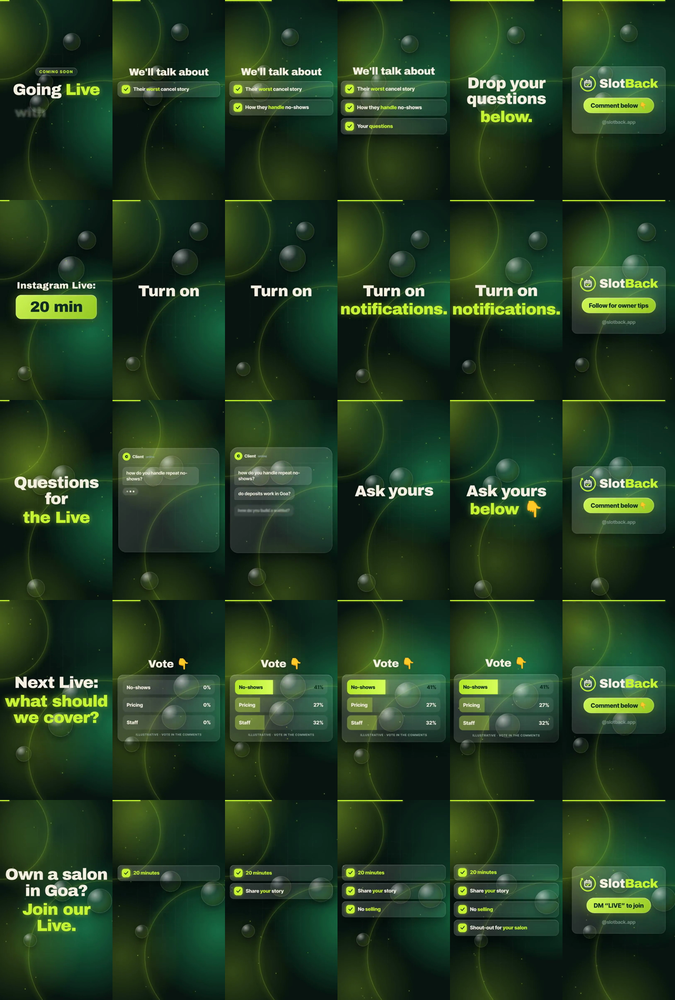

| # | Angle | Title | Length | CTA | Preview |
| --- | --- | --- | --- | --- | --- |
| v1 | story | [Going live with a Goa owner](SCRIPTS.md#pC9-v1-going-live-with-a-goa-owner) | 13.3s | Comment below 👇 | [mp4](previews/pC9-v1-going-live-with-a-goa-owner.mp4) |
| v2 | quickfire | [Live: save the date](SCRIPTS.md#pC9-v2-live-save-the-date) | 13.3s | Follow for owner tips | [mp4](previews/pC9-v2-live-save-the-date.mp4) |
| v3 | chat | [Questions for the Live](SCRIPTS.md#pC9-v3-questions-for-the-live) | 13.3s | Comment below 👇 | [mp4](previews/pC9-v3-questions-for-the-live.mp4) |
| v4 | poll | [What should the Live cover?](SCRIPTS.md#pC9-v4-what-should-the-live-cover) | 13.3s | Comment below 👇 | [mp4](previews/pC9-v4-what-should-the-live-cover.mp4) |
| v5 | checklist | [Owners: want to join a Live?](SCRIPTS.md#pC9-v5-owners-want-to-join-a-live) | 13.3s | DM “LIVE” to join | [mp4](previews/pC9-v5-owners-want-to-join-a-live.mp4) |

## C10 · The 3 messages I'd send if I owned a salon

| # | Angle | Title | Length | CTA | Preview |
| --- | --- | --- | --- | --- | --- |
| v1 | chat | [3 messages I'd send](SCRIPTS.md#pC10-v1-3-messages-i-d-send) | 13.3s | Save this for your next cancel | [mp4](previews/pC10-v1-3-messages-i-d-send.mp4) |
| v2 | list | [Message 1, 2, 3](SCRIPTS.md#pC10-v2-message-1-2-3) | 13.3s | Save this for your next cancel | [mp4](previews/pC10-v2-message-1-2-3.mp4) |
| v3 | quickfire | [Remind · Offer · Rebook](SCRIPTS.md#pC10-v3-remind-offer-rebook) | 13.3s | Free toolkit · link in bio | [mp4](previews/pC10-v3-remind-offer-rebook.mp4) |
| v4 | versus | [What most send vs what works](SCRIPTS.md#pC10-v4-what-most-send-vs-what-works) | 13.3s | Save this for your next cancel | [mp4](previews/pC10-v4-what-most-send-vs-what-works.mp4) |
| v5 | checklist | [Copy these today](SCRIPTS.md#pC10-v5-copy-these-today) | 13.3s | Save this for your next cancel | [mp4](previews/pC10-v5-copy-these-today.mp4) |

## C11 · Creator takeover: a stylist runs our Stories

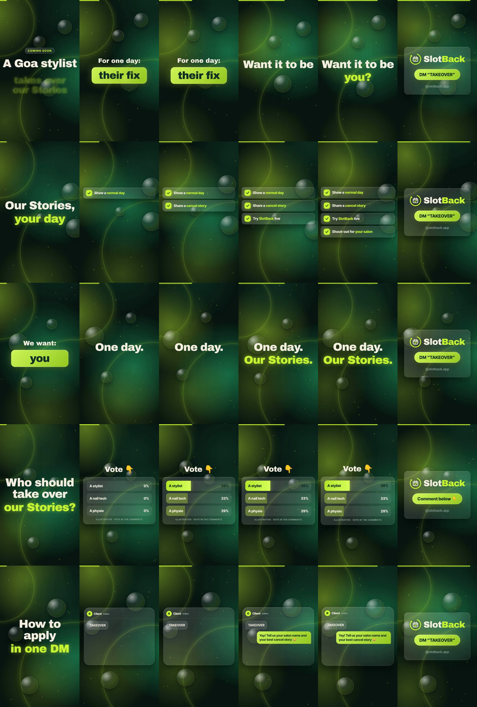

| # | Angle | Title | Length | CTA | Preview |
| --- | --- | --- | --- | --- | --- |
| v1 | story | [A stylist takes over our Stories](SCRIPTS.md#pC11-v1-a-stylist-takes-over-our-stories) | 13.3s | DM “TAKEOVER” | [mp4](previews/pC11-v1-a-stylist-takes-over-our-stories.mp4) |
| v2 | checklist | [Takeover: what you'd do](SCRIPTS.md#pC11-v2-takeover-what-you-d-do) | 13.3s | DM “TAKEOVER” | [mp4](previews/pC11-v2-takeover-what-you-d-do.mp4) |
| v3 | quickfire | [Stylists of Goa, apply](SCRIPTS.md#pC11-v3-stylists-of-goa-apply) | 13.3s | DM “TAKEOVER” | [mp4](previews/pC11-v3-stylists-of-goa-apply.mp4) |
| v4 | poll | [Who should take over?](SCRIPTS.md#pC11-v4-who-should-take-over) | 13.3s | Comment below 👇 | [mp4](previews/pC11-v4-who-should-take-over.mp4) |
| v5 | chat | [Takeover DM](SCRIPTS.md#pC11-v5-takeover-dm) | 13.3s | DM “TAKEOVER” | [mp4](previews/pC11-v5-takeover-dm.mp4) |

## C12 · What your Instagram bio should say

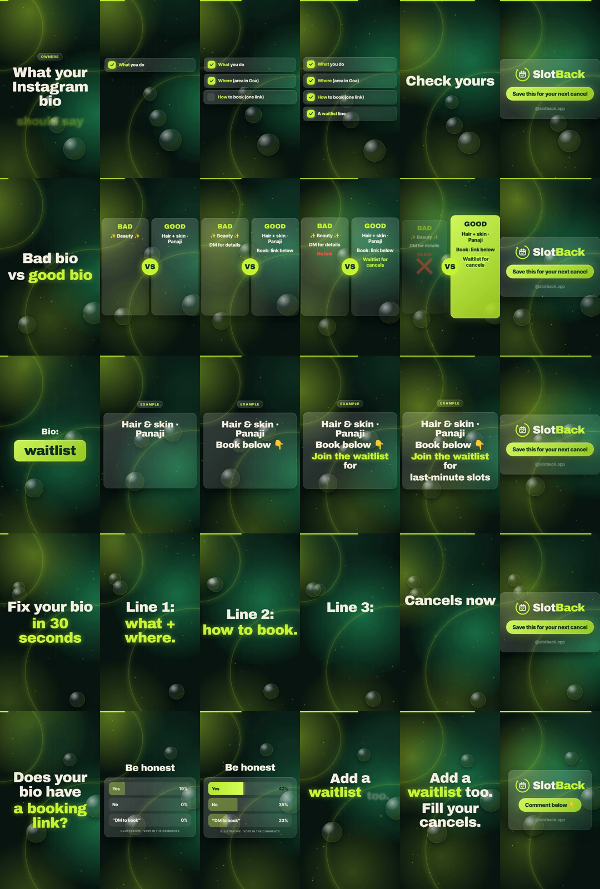

| # | Angle | Title | Length | CTA | Preview |
| --- | --- | --- | --- | --- | --- |
| v1 | checklist | [What your bio should say](SCRIPTS.md#pC12-v1-what-your-bio-should-say) | 13.3s | Save this for your next cancel | [mp4](previews/pC12-v1-what-your-bio-should-say.mp4) |
| v2 | versus | [Bad bio vs good bio](SCRIPTS.md#pC12-v2-bad-bio-vs-good-bio) | 13.3s | Save this for your next cancel | [mp4](previews/pC12-v2-bad-bio-vs-good-bio.mp4) |
| v3 | quickfire | [Bio in 4 lines](SCRIPTS.md#pC12-v3-bio-in-4-lines) | 13.3s | Save this for your next cancel | [mp4](previews/pC12-v3-bio-in-4-lines.mp4) |
| v4 | story | [Fix your bio in 30 seconds](SCRIPTS.md#pC12-v4-fix-your-bio-in-30-seconds) | 13.3s | Save this for your next cancel | [mp4](previews/pC12-v4-fix-your-bio-in-30-seconds.mp4) |
| v5 | poll | [Does your bio have a booking link?](SCRIPTS.md#pC12-v5-does-your-bio-have-a-booking-link) | 13.3s | Comment below 👇 | [mp4](previews/pC12-v5-does-your-bio-have-a-booking-link.mp4) |

## C13 · Free vs paid booking tools

| # | Angle | Title | Length | CTA | Preview |
| --- | --- | --- | --- | --- | --- |
| v1 | versus | [Free vs paid booking tools](SCRIPTS.md#pC13-v1-free-vs-paid-booking-tools) | 16.5s | DM “DEMO” for a free demo | [mp4](previews/pC13-v1-free-vs-paid-booking-tools.mp4) |
| v2 | checklist | [What actually matters](SCRIPTS.md#pC13-v2-what-actually-matters) | 13.3s | Save this for your next cancel | [mp4](previews/pC13-v2-what-actually-matters.mp4) |
| v3 | quickfire | [Tools vs the real problem](SCRIPTS.md#pC13-v3-tools-vs-the-real-problem) | 13.3s | DM “DEMO” for a free demo | [mp4](previews/pC13-v3-tools-vs-the-real-problem.mp4) |
| v4 | poll | [What do you use now?](SCRIPTS.md#pC13-v4-what-do-you-use-now) | 13.3s | Comment below 👇 | [mp4](previews/pC13-v4-what-do-you-use-now.mp4) |
| v5 | story | [Keep your tool, fix the cancels](SCRIPTS.md#pC13-v5-keep-your-tool-fix-the-cancels) | 13.3s | DM “DEMO” for a free demo | [mp4](previews/pC13-v5-keep-your-tool-fix-the-cancels.mp4) |

## C14 · Is a waitlist worth it?

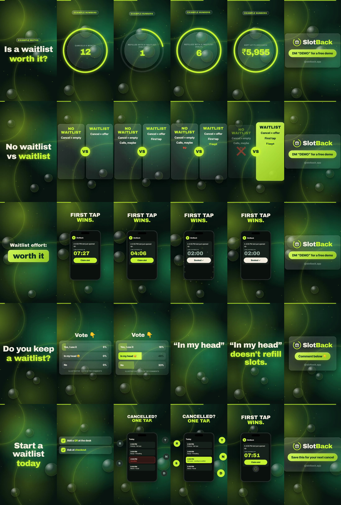

| # | Angle | Title | Length | CTA | Preview |
| --- | --- | --- | --- | --- | --- |
| v1 | numbers | [Is a waitlist worth it?](SCRIPTS.md#pC14-v1-is-a-waitlist-worth-it) | 13.3s | DM “DEMO” for a free demo | [mp4](previews/pC14-v1-is-a-waitlist-worth-it.mp4) |
| v2 | versus | [No waitlist vs waitlist](SCRIPTS.md#pC14-v2-no-waitlist-vs-waitlist) | 13.3s | DM “DEMO” for a free demo | [mp4](previews/pC14-v2-no-waitlist-vs-waitlist.mp4) |
| v3 | quickfire | [Worth it? Yes.](SCRIPTS.md#pC14-v3-worth-it-yes) | 13.3s | DM “DEMO” for a free demo | [mp4](previews/pC14-v3-worth-it-yes.mp4) |
| v4 | poll | [Do you keep a waitlist?](SCRIPTS.md#pC14-v4-do-you-keep-a-waitlist) | 13.3s | Comment below 👇 | [mp4](previews/pC14-v4-do-you-keep-a-waitlist.mp4) |
| v5 | checklist | [Start a waitlist today](SCRIPTS.md#pC14-v5-start-a-waitlist-today) | 13.3s | Save this for your next cancel | [mp4](previews/pC14-v5-start-a-waitlist-today.mp4) |
